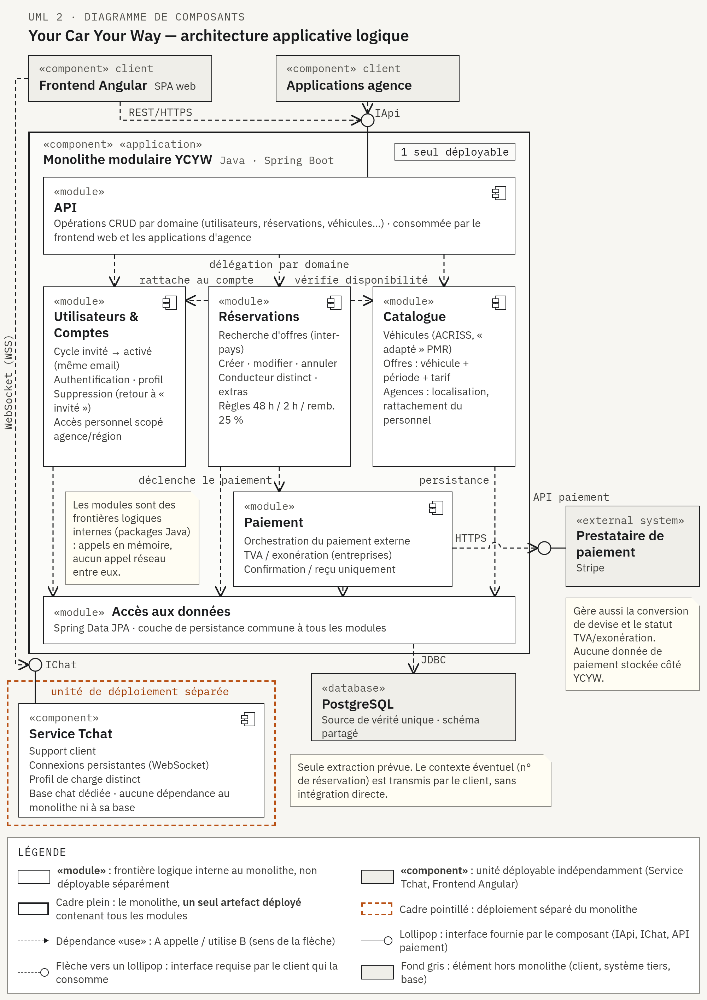
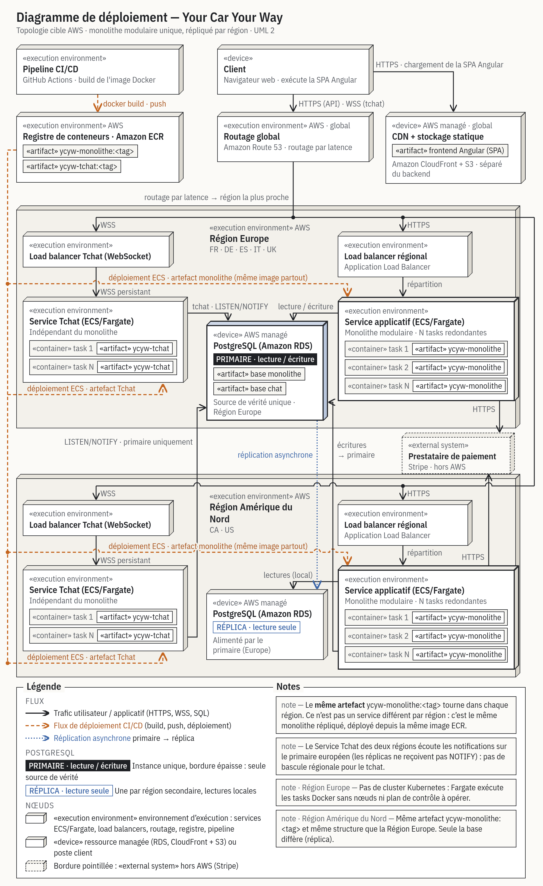
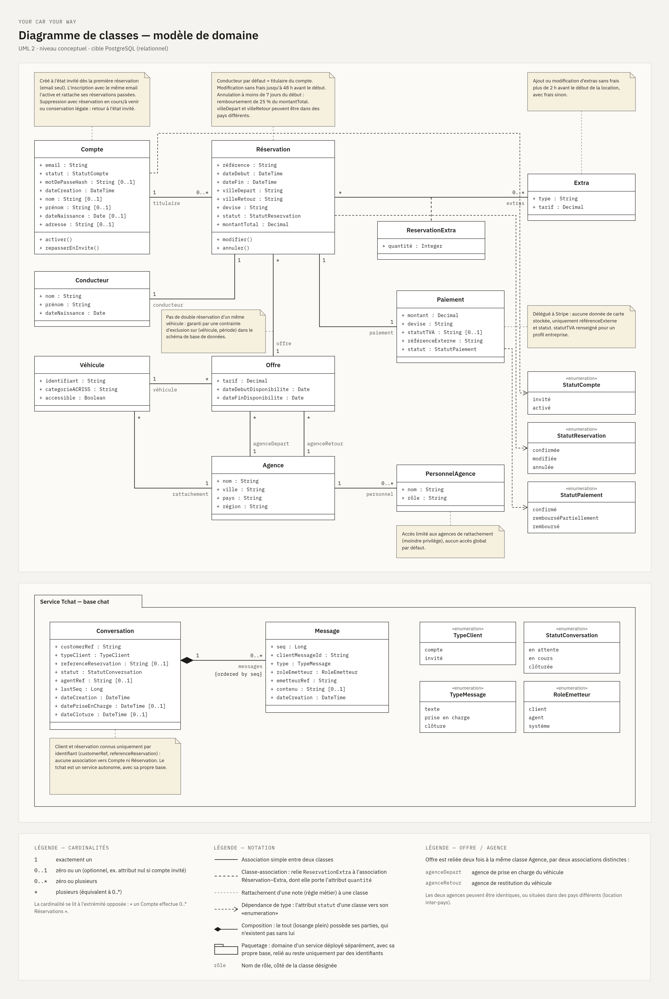

# Proposition d'architecture — Your Car Your Way (brouillon de travail)

> Document de travail, livrable 2. Rempli progressivement.

## 1. Audit de l'existant

### 1.1 Cartographie de l'architecture existante

**Par pays**

| Pays | Backend | Frontend | Hébergement | Architecture | Particularité |
|---|---|---|---|---|---|
| FR (historique) | Java EE | JSP/JSF | OVH, déploiement manuel | Monolithe complet (auth, catalogue, réservation, paiement) | Base technique la plus ancienne ; socle des déclinaisons DE/ES/IT |
| DE/ES/IT | Java EE (dérivé FR) | JSP/JSF | OVH | Monolithe | Code copié/adapté → divergence progressive, règles métier parfois différentes d'un pays à l'autre |
| UK | PHP Laravel | — | AWS EC2 classique | Monolithe | Issue d'un rachat, isolée, modèle de données et règles de réservation différents |
| CA | Node.js | React | AWS | Monolithe (backend) | Tentative de modernisation UX, jamais généralisée aux autres pays |
| US | Spring Boot | Angular | Azure (containers) | Monolithe, mais seule application containerisée | Projet le plus ambitieux techniquement, jamais généralisé |

**Architecture globale**

- 100 % monolithes web — aucun microservice, sur aucun des 4 systèmes.
- APIs limitées, hétérogènes, non unifiées entre pays.
- Chaque pays possède sa propre base de données, avec un schéma divergent — pas de partage de données automatisé entre systèmes.
- Conséquence directe : 4 silos technologiques indépendants, sans garantie de cohérence fonctionnelle entre eux (fonctionnalités divergentes DE/ES/IT, modèle de données et règles de réservation propres au UK).

### 1.2 Critères d'audit

*Liste ouverte, à consolider une fois tous les critères passés en revue — un même constat peut servir plusieurs critères à la fois (ex. maintenabilité et fiabilité se recoupent sur ce système).*

**Maintenabilité** : la capacité du système à être compris, corrigé et fait évoluer dans le temps, sans introduire de régressions ni de divergences entre les différentes versions/déploiements.

**Performance** : la capacité du système à traiter un volume de requêtes donné rapidement et sans dégradation, notamment sous charge.

**Disponibilité** : la proportion du temps pendant laquelle le système est accessible aux utilisateurs, toutes causes d'indisponibilité confondues (incidents et maintenance planifiée).

**Fiabilité** : la capacité du système à fonctionner sans défaillance imprévue et à se rétablir rapidement et correctement lorsqu'un incident survient.

**Évolutivité** : la capacité du système à accueillir de nouvelles fonctionnalités, de nouveaux marchés, et une charge croissante, sans nécessiter une refonte complète.

**Sécurité** : la capacité du système à protéger les données et les accès contre les menaces (accès non autorisé, interception, exploitation de vulnérabilités connues), au moyen de mécanismes de protection éprouvés et à jour.

### 1.3 Audit détaillé

**Maintenabilité**
- Code source DE/ES/IT "souvent copié/adapté" depuis le socle FR, entraînant une divergence progressive et des règles métier parfois différentes d'un pays à l'autre — évolution non maîtrisée du code au fil du temps.
- Taux de réussite des déploiements : 82 % sur OVH (déploiements manuels) contre 91 % sur cloud (UK/CA/US) — un système difficile à faire évoluer sans erreur.
- Délai moyen de stabilisation après mise à jour : 3,4 jours (OVH) contre 1,7 jour (cloud) — cohérent avec un système plus difficile à corriger une fois un problème détecté.
- *(Ces deux dernières statistiques recoupent également le critère Fiabilité — se référer à cette section plutôt que de dupliquer l'analyse.)*

**Performance**
- Charge maximale sans dégradation : ≈150 req/s (FR/DE/ES/IT) contre 250 à 350 req/s (UK/CA/US) — le socle historique supporte quasiment deux fois moins de trafic.
- Taux d'erreur lors des pics de trafic saisonniers : jusqu'à 4 % (FR/DE/ES/IT) contre 0,8 à 1,5 % (UK/CA/US) — le système historique se dégrade nettement plus sous charge.

**Disponibilité**
- Taux de disponibilité moyen (12 mois) : 97,2 % (FR/DE/ES/IT) contre 98,6-98,9 % (UK/CA/US) — écart cohérent avec des déploiements manuels/une maintenance plus lourde sur OVH (cf. Maintenabilité).
- Redondance : aucune réplication des instances applicatives (FR/DE/ES/IT) contre réplication partielle (UK/CA) et application containerisée mais base non redondante (US) — absence de redondance = exposition plus forte en cas de panne matérielle.
- ⚠️ **Incohérence des chiffres à vérifier avec le mentor** : le taux de 97,2 % implique environ 20h d'indisponibilité mensuelle, très supérieur aux 21-28 minutes/mois indiquées plus bas (Fiabilité). Hypothèse retenue pour ce brouillon : le taux de disponibilité inclut les interruptions planifiées (maintenance, déploiements), alors que le chiffre en minutes ne couvre que les incidents non planifiés. À confirmer, et l'hypothèse elle-même reste fragile : elle impliquerait environ 20h de maintenance planifiée par mois (2,8 % de ~730h, moins ~25 min d'incidents), ce qui est très élevé même pour des déploiements manuels. Le point reste donc ouvert, et l'une des deux données de l'énoncé est peut-être erronée.

**Fiabilité**
- Temps moyen d'indisponibilité mensuel (incidents non planifiés, cf. hypothèse ci-dessus) : 21 à 28 min (FR/DE/ES/IT) contre 7 à 16 min (UK/CA/US).
- MTTR (temps de récupération après incident) : 2h45 (OVH) contre 1h10 (AWS/Azure) — une fois un incident survenu, deux fois plus de temps pour y remédier sur l'infrastructure historique.
- Sauvegardes : manuelles, quotidiennes, restauration non testée (FR/DE/ES/IT) contre snapshots quotidiens non testés (UK/CA) contre sauvegardes automatisées avec test de restauration tous les 90 jours (US) — capacité de récupération après perte de données très inégale ; l'existant historique présente le risque le plus élevé (sauvegarde jamais testée = fiabilité de récupération non prouvée).

**Évolutivité**
- L'architecture est monolithique, ce qui n'est pas en soi un problème si le monolithe est bien structuré. Mais rien dans l'existant ne l'indique : le code copié/adapté entre pays, l'absence d'API interne et les schémas de données divergents suggèrent au contraire un manque de modularité — c'est ce manque de structuration, et non le choix du monolithe en lui-même, qui limite l'évolutivité actuelle.
- Aucune base de données ou API commune entre pays : chaque marché est un silo isolé, sans fondation partagée sur laquelle étendre le système.
- Tentatives d'évolution passées non généralisées : le Canada (React/Node, "première tentative d'unification visuelle, restée locale") et les États-Unis (seule application containerisée, "projet plus ambitieux, jamais généralisé") montrent que même les efforts de modernisation n'ont jamais dépassé le cadre d'un seul pays.
- Scalabilité d'infrastructure : seule l'application US est containerisée — les 4 autres nécessiteraient une refonte d'infrastructure, pas seulement une configuration, pour absorber une charge croissante.

**Sécurité**
- Hashage des mots de passe : SHA-1 (FR/DE/ES/IT) — algorithme déprécié pour cet usage depuis plus d'une décennie, cassable avec du matériel courant — contre bcrypt/argon2id (UK/CA/US), standards actuels recommandés. *(à vérifier)*
- Chiffrement du trafic : TLS 1.0 toujours utilisé (FR, IT) — protocole officiellement déprécié (RFC 8996, 2021), vulnérable à des attaques connues (BEAST, POODLE), abandonné par les navigateurs majeurs depuis 2020. *(à vérifier)*
- Gestion des secrets : secrets stockés en fichiers de configuration sur serveur (FR/DE/ES/IT), sans rotation ni contrôle d'accès dédié — contre des approches plus structurées mais encore incomplètes ailleurs (variables d'environnement sans rotation sur UK/CA, KeyVault partiel sur US).
- Dépendances vulnérables : 35-41 % des paquets (FR/DE/ES/IT) contre 11-22 % (UK/CA/US) — la plus grande surface d'exposition à des vulnérabilités déjà documentées.

### 1.4 Conclusion

| Critère | Verdict | Justification courte |
|---|---|---|
| Maintenabilité | **Non validé** | Divergence par copier/adapter entre pays, faible taux de réussite des déploiements (82 %), stabilisation lente (3,4 j). |
| Performance | **Non validé** (socle historique) | FR/DE/ES/IT supportent ~150 req/s contre 250-350 ailleurs ; même les systèmes les plus récents montrent une dégradation non nulle sous pic (0,8-1,5 %). |
| Disponibilité | **Partiellement validé, mais fragile** | Les taux affichés (97,2-98,9 %) semblent corrects en façade, mais l'absence totale de redondance (FR/DE/ES/IT) en fait un résultat non robuste : un seul incident matériel suffirait à dégrader fortement ce chiffre. |
| Fiabilité | **Non validé** | MTTR deux fois plus long sur l'infrastructure historique (2h45 vs 1h10), sauvegardes jamais testées (FR/DE/ES/IT, UK/CA) — la capacité de récupération n'est démontrée nulle part de façon robuste, pas même sur US (test tous les 90 jours seulement). |
| Évolutivité | **Non validé, sur aucun des 4 systèmes** | Même les tentatives de modernisation (CA, US) ne sont jamais sorties du périmètre d'un seul pays ; absence totale de socle de données ou d'API partagé entre marchés. |
| Sécurité | **Non validé (historique) / partiellement validé (récent)** | FR/DE/ES/IT cumulent les pratiques dépréciées (SHA-1, TLS 1.0, secrets non gérés, 35-41 % de dépendances vulnérables) ; UK/CA/US suivent de meilleures pratiques mais gardent des lacunes (pas de rotation des secrets, KeyVault partiel). |

*Note sur le verdict Sécurité* : deux des constats qui le fondent (hashage SHA-1, TLS 1.0) sont marqués « à vérifier » en §1.3. Le verdict « Non validé » du socle historique tient même s'ils étaient infirmés, car il repose aussi sur des constats non contestés (secrets en fichiers de configuration sans rotation, 35-41 % de dépendances vulnérables) ; il serait en revanche à nuancer dans sa justification.

**Synthèse** : aucun des quatre systèmes existants ne satisfait pleinement les critères retenus. Le socle historique (FR/DE/ES/IT) échoue sur la quasi-totalité d'entre eux. Les systèmes plus récents (UK, CA, US) se comportent nettement mieux sur les critères opérationnels (performance, disponibilité, fiabilité, sécurité), mais échouent eux aussi sur le critère le plus déterminant pour cette mission — l'évolutivité : aucun n'a jamais réussi à s'étendre au-delà d'un seul pays, faute de socle de données ou d'API partagé. Cela confirme qu'il ne s'agit pas de corriger ou d'étendre l'un des systèmes actuels, mais de concevoir une architecture cible commune, pensée dès le départ pour l'ensemble des marchés.

---

## 2. Spécifications techniques et architecture cible

### 2.1 Spécifications techniques

**Authentification et comptes**
- Système de création de compte / connexion / récupération de mot de passe (absent de l'existant, cf. cahier des charges §1).
- Modèle de compte "invité → activé" : un enregistrement lié à l'email existe dès la première réservation, devient un compte complet lors de l'inscription avec le même email.
- Suppression de compte : ramène le compte à l'état "invité" si une réservation est en cours/à venir ou si des données doivent être légalement conservées, plutôt qu'une suppression totale.

**Internationalisation**
- Recherche et réservation inter-pays (ville de départ ≠ pays de la ville de retour).
- Devise déterminée par le pays de la ville de départ ; conversion déléguée au prestataire de paiement.
- Interface multilingue (socle FR/EN/DE/ES/IT), conçue pour permettre l'ajout de langues sans refonte.
- **Point ouvert (repris du cahier des charges, §2)** : obligations linguistiques propres à certaines juridictions, en particulier au Québec (Charte de la langue française, renforcée par la loi 96 en 2022), à vérifier avant l'ouverture du marché CA. Le socle multilingue couvre déjà le français ; l'enjeu porte sur les obligations éventuelles (français par défaut, documents contractuels en français), pas sur l'architecture.

**Accessibilité**
- Conformité aux standards d'accessibilité (WCAG/RGAA) sur l'ensemble du parcours : navigation clavier, compatibilité lecteur d'écran, structure sémantique.

**Sécurité** *(directement informé par l'audit, §1.3)*
- Hashage des mots de passe avec un algorithme moderne (argon2id ou bcrypt) — jamais SHA-1.
- TLS 1.2 minimum (idéalement 1.3) uniquement — pas de support legacy TLS 1.0.
- Gestion des secrets via un mécanisme dédié avec rotation (pas de secrets en fichier de configuration).
- Scan de vulnérabilités des dépendances intégré au pipeline (pas de contrôle ponctuel seulement).
- Aucune collecte/stockage de pièce d'identité ou permis de conduire — vérification physique en agence.
- Accès du personnel d'agence scopé par région/agence (moindre privilège).

**Données et architecture globale**
- Un socle de données logiquement unifié (remplace les 4 schémas divergents actuels) — condition nécessaire à la recherche/réservation inter-pays et à l'évolutivité (cf. conclusion de l'audit, §1.4).
- Les données (comptes, réservations, catalogue véhicules/offres) doivent rester accessibles globalement, quelle que soit la région de l'utilisateur ou du serveur qui traite la requête — la distribution géographique des serveurs ne doit pas fragmenter les données en silos régionaux (cf. résidence des données ci-dessous).
- **Résidence des données (point ouvert du cahier des charges, §2, tranché ici).** La topologie retenue (un seul primaire PostgreSQL en Europe, un réplica en lecture en Amérique du Nord, §2.2) suppose qu'aucune obligation légale n'impose de stocker les données d'un pays dans ce pays. Vérification faite le 22/10/2026 :
  - **Pas d'obligation de localisation identifiée** pour une entreprise privée de location dans les 7 pays. Le RGPD (UE) et le UK GDPR n'imposent pas de stockage en Europe : ils encadrent les *transferts* hors de leur territoire (chapitre V du RGPD, articles 44 à 49). Au Canada, la loi fédérale PIPEDA ne fixe pas d'obligation de localisation : elle repose sur la responsabilité de l'organisation, qui doit garantir par contrat un niveau de protection comparable lorsque les données sont traitées ailleurs [OPC]. Pas de règle fédérale de localisation aux États-Unis pour ce type de données.
  - **Choix de conception, au-delà du droit** : cloisonner les données par pays ou par région rendrait l'exploitation lourde (un schéma et des sauvegardes par pays, des migrations à synchroniser) et casserait l'usage normal du service : un client européen qui loue aux États-Unis, ou l'inverse, doit retrouver son compte et ses réservations. C'est précisément le défaut de l'existant (§1.3, silos par pays).
  - **Conditions à respecter** (le réplica nord-américain reçoit une copie des données des clients européens, ce qui constitue un transfert au sens du RGPD) :
    1. *Vers les États-Unis* : clauses contractuelles types de la Commission européenne, intégrées à l'avenant RGPD d'AWS (Data Processing Addendum) [AWS-SCC]. AWS déclare aussi participer au EU-US Data Privacy Framework et à son extension britannique [AWS-DPF, ICO], mais ce cadre n'est pas retenu comme fondement unique : confirmé par le Tribunal de l'UE en septembre 2025, il fait l'objet d'un pourvoi devant la CJUE (C-703/25 P), et le CEPD a demandé en juillet 2026 son réexamen à la suite de la décision de la Cour suprême américaine Trump v. Slaughter [DPF-1, DPF-2].
    2. *Vers le Canada* (si le réplica est placé dans une région AWS canadienne) : décision d'adéquation de la Commission européenne, confirmée lors de sa revue de janvier 2024 [CA-ADQ].
    3. *Québec (loi 25, article 17)* : une évaluation des facteurs relatifs à la vie privée est obligatoire avant de communiquer hors du Québec des renseignements personnels qui y ont été recueillis, y compris lorsqu'ils sont confiés à un prestataire. C'est le cas ici (primaire en Europe). La Commission d'accès à l'information publie un guide et un modèle pour cette évaluation [QC-25].
  - **Plan de repli** si un pays impose un jour une localisation : un primaire régional pour ce pays (le schéma est commun, seule la topologie change), et, pour le tchat, la bascule vers Redis pub/sub déjà documentée comme critère de réouverture (§2.2, diffusion temps réel).
  - *Sources consultées le 22/10/2026, essentiellement secondaires (cabinets d'avocats, éditeurs, pages des fournisseurs) : à faire valider par un juriste avant mise en production.* [OPC] [Commissariat à la protection de la vie privée du Canada, lignes directrices sur le traitement transfrontalier](https://www.priv.gc.ca/en/privacy-topics/personal-information-transferred-across-borders/gl_dab_090127/) ; [Torys, 2019](https://www.torys.com/en/our-latest-thinking/publications/2019/09/opc-not-changing-guidelines-on-transfers-for-processing). [AWS-SCC] [AWS Security Blog, clauses contractuelles types dans le DPA AWS](https://aws.amazon.com/blogs/security/new-standard-contractual-clauses-now-part-of-the-aws-gdpr-data-processing-addendum-for-customers). [AWS-DPF] [Amazon, participation au DPF](https://digprjsurvey.amazon.com/csad/help/node/G202135380) (statut actif à vérifier sur dataprivacyframework.gov). [ICO] [ICO, UK Extension du DPF](https://ico.org.uk/for-organisations/uk-gdpr-guidance-and-resources/international-transfers/adequacy-regulations/how-does-the-uk-extension-to-the-eu-us-data-privacy-framework-work). [DPF-1] [Skadden, 07/2026](https://www.skadden.com/insights/publications/2026/07/supreme-court-decision-raises-new-questions) ; [DPF-2] [Hunton, avis du CEPD](https://www.hunton.com/privacy-and-cybersecurity-law-blog/edpb-calls-for-review-of-eu-u-s-data-privacy-framework-after-u-s-supreme-court-decision-on-ftc-independence). [CA-ADQ] [WeirFoulds, revue de l'adéquation canadienne](https://www.weirfoulds.com/canadas-privacy-protections-stand-strong) ; [McMillan](https://mcmillan.ca/insights/publications/privacy-on-ice-canada-maintains-gdpr-adequacy-status-despite-frozen-privacy-reforms/). [QC-25] [McCarthy Tétrault, guide de la CAI sur les évaluations de la loi 25](https://www.mccarthy.ca/en/insights/blogs/techlex/quebec-privacy-regulators-guide-law-25-compliant-privacy-impact-assessments) ; [IAPP](https://iapp.org/news/a/iapp-cps-23-forthcoming-quebec-privacy-regulations-situate-province-between-canada-and-europe).

**API**
- API exposant les données (utilisateurs, réservations, véhicules...) avec opérations CRUD par domaine, pour les applications utilisées en agence (déjà requis au cahier des charges).

**Paiement et fiscalité**
- Paiement intégralement délégué à un prestataire externe (Stripe) — aucune donnée de paiement stockée.
- Statut de TVA/exonération pour les profils entreprise, pris en charge nativement par le prestataire (Stripe Tax — à vérifier).
- Aucun moteur de facturation interne — reçu de paiement standard pour tous les profils.

**Fiabilité et disponibilité** *(informé par l'audit, §1.3)*
- Redondance des instances applicatives (pas de point de défaillance unique, contrairement à l'existant FR/DE/ES/IT).
- Sauvegardes automatisées et testées régulièrement (contrairement à l'existant, jamais testé sur le socle historique).
- Déploiements automatisés (CI/CD) — remplace les déploiements manuels, identifiés comme cause probable du faible taux de réussite des déploiements et du MTTR élevé de l'existant.

**Performance et évolutivité** *(informé par l'audit, §1.3, et par la discussion sur la charge combinée)*
- Infrastructure conçue pour le scaling horizontal (containerisation), contrairement à l'existant (1 seule application containerisée sur 4).
- Capacité à absorber une charge significativement supérieure à celle de n'importe quel système actuel pris isolément, sans nécessiter la somme brute des pics de chaque marché (les marchés ne sont pas supposés être simultanément au pic).
- Architecture pensée dès le départ pour accueillir de nouveaux marchés/fonctionnalités sans refonte complète.

### 2.2 Choix technologiques

**Critères d'évaluation, par ordre de priorité**

1. **Adéquation fonctionnelle et technique** (priorité la plus haute) : la solution répond-elle aux spécifications techniques (§2.1) et corrige-t-elle les faiblesses identifiées à l'audit (§1.3) — API-first/données unifiées, accessibilité, i18n, scalabilité horizontale, sécurité, CI/CD ?
2. **Contraintes organisationnelles** (secondaires, départagent entre options par ailleurs proches) : compétences déjà présentes dans l'équipe, coût, réutilisation d'un fournisseur cloud déjà en place.

**Justification de cet ordre** : l'audit montre que l'organisation est déjà capable d'adopter une stack entièrement nouvelle avec succès (US : Angular/Spring Boot/Azure, containerisé — seule application de l'existant à l'être). La familiarité de l'équipe avec une technologie n'est donc pas un facteur bloquant ; elle ne doit faire pencher la balance qu'entre deux options par ailleurs équivalentes sur le plan technique.

**Style d'architecture**

Option retenue : **monolithe modulaire structuré selon les principes du Domain-Driven Design (DDD)** — une application unique en déploiement, mais strictement découpée en modules de domaine (ex. Utilisateurs, Réservations, Catalogue véhicules, Paiement), avec des frontières explicites entre modules.

Alternatives écartées :
- **Microservices** : complexité opérationnelle (orchestration, observabilité distribuée, cohérence transactionnelle inter-services) disproportionnée par rapport à la taille de l'équipe et au périmètre fonctionnel ; l'audit ne révèle aucune limite de l'existant qui nécessiterait ce niveau de granularité.
- **Serverless** : mauvais ajustement pour une charge soutenue et prévisible (réservations, paiement) plutôt que des pics ponctuels isolés ; complique la gestion d'état et les transactions multi-étapes du parcours de réservation.

Justification : l'audit (§1.3) attribue les faiblesses de maintenabilité et d'évolutivité de l'existant non pas au style « monolithe » en tant que tel, mais à l'absence de modularité interne (code copié/adapté entre pays, aucune API interne, schémas de données divergents). Un monolithe modulaire DDD corrige directement cette cause racine, sans ajouter la complexité opérationnelle des microservices.

**Choix du langage/framework backend**

Candidats évalués : Java + Spring Boot, .NET / C# (ASP.NET Core), Node.js + NestJS (TypeScript), PHP + Laravel, Python + Django — les technologies déjà présentes dans l'existant (Spring Boot, Laravel, l'équivalent Node de NestJS), complétées par deux alternatives absentes du parc actuel (.NET, Django), pour ne pas limiter la comparaison aux seuls choix hérités.

Méthode : notation de 1 (mauvais) à 10 (excellent) par critère, sur l'adéquation technique pure — la compétence déjà présente dans l'équipe est traitée séparément, en tant que critère de priorité 2 (départage uniquement entre options techniquement proches). Pour limiter le risque de biais de confirmation, la notation a été réalisée deux fois indépendamment : une première fois en interne, une seconde par un agent IA sans connaissance préalable du projet ni des scores déjà obtenus. Les deux évaluations convergent sur le classement :

| Critère | Spring Boot | .NET | NestJS | Laravel | Django |
|---|---|---|---|---|---|
| Modularité / DDD | 9 — Spring Modulith, frontières vérifiées à la compilation | 8 — assemblies + analyseurs Roslyn | 8 — modules imposés, frontières non vérifiées | 4 — aucune frontière imposée, dépend de la discipline | 4 — "apps" permettent une bonne modularité si suivies, non imposée |
| Support i18n | 9 — `MessageSource` intégré, mature | 9 — `System.Globalization` intégré, mature | 5 — pas de module officiel, packages tiers variables | 8 — natif, pluralisation complexe limitée | 9 — `django.utils.translation` intégré, mature |
| Hashage de mot de passe moderne | 9 — bcrypt/argon2 par défaut recommandé | 7 — nécessite config explicite d'Identity | 5 — rien nativement, à la charge de l'équipe | 9 — bcrypt/argon2 par défaut recommandé | 8 — PBKDF2 par défaut, argon2 en option |
| Maturité | 9 — +10 ans de prod à grande échelle | 8 — +10 ans de prod à grande échelle | 5 — le plus récent, retours limités | 7 — mûr, historiquement moindre échelle | 9 — +10 ans de prod à grande échelle |
| Typage statique | 10 — typé de bout en bout (Java) | 10 — typé de bout en bout (C#) | 8 — TypeScript, contournable à l'exécution | 3 — langage dynamique (PHP) | 3 — langage dynamique (Python) |
| Modèle de concurrence (charge I/O-bound) | 7 — threads-bloquants par défaut | 9 — async/await natif | 9 — event loop Node.js natif | 5 — synchrone par défaut | 5 — synchrone par défaut |
| ORM / accès aux données | 9 — Hibernate/Spring Data JPA, mûr mais verbeux | 9 — Entity Framework, mûr mais verbeux | 5 — pas d'ORM officiel (TypeORM/Prisma tiers) | 10 — Eloquent, le plus simple d'usage | 10 — ORM intégré, le plus simple d'usage |
| **Total /70** | **62** | **60** | **45** | **46** | **48** |

Point de vigilance documenté : le critère « modularité/DDD » ne distingue pas d'outillage DDD strict dans tous les frameworks — un développeur expérimenté peut structurer proprement n'importe lequel d'entre eux par seule discipline (c'est notamment le cas de Django, dont les « apps » permettent une bonne modularité si les conventions sont suivies). Le choix privilégie malgré tout les mécanismes imposés/outillés nativement par le framework plutôt que la discipline d'équipe seule, précisément parce que l'audit (§1.3) montre que l'absence d'un tel garde-fou est ce qui a produit la divergence de code dans l'existant.

**Décision : Java + Spring Boot.**

Justification : meilleur score sur les deux évaluations indépendantes, cohérent avec la priorité 1 (adéquation technique). Sur le critère secondaire (priorité 2, compétences déjà présentes) : l'équipe US a déjà shippé en production sur Spring Boot/Angular/Azure containerisé — seule application de l'existant containerisée — ce qui confirme à la fois une compétence déjà disponible sur ce choix et la capacité de l'organisation à adopter une nouvelle stack avec succès.

**Choix de la base de données**

Modèle de données retenu : **relationnel**. Le cœur du domaine (utilisateurs, réservations, véhicules, agences, paiements) a des besoins de cohérence transactionnelle stricts (pas de double réservation, pas de paiement orphelin) qui correspondent directement aux garanties ACID. Un SGBD NoSQL (document/clé-valeur) est écarté comme système de référence : sa flexibilité de schéma referait courir le risque exact identifié à l'audit (§1.3) — des structures de données divergentes d'un pays à l'autre, faute de schéma commun imposé. Cela n'exclut pas d'introduire, plus tard, un outil non relationnel complémentaire pour un besoin ponctuel (cache, recherche plein texte dédiée) — mais pas en remplacement du système de référence.

Candidats évalués : PostgreSQL, MySQL/MariaDB, Microsoft SQL Server, Oracle Database.

Méthode : même protocole que pour le choix du backend — notation indépendante interne, puis par un agent IA sans connaissance préalable du projet, sur le mérite technique pur (le coût de licence est traité séparément ci-dessous, en tant que critère de priorité 2). Les deux évaluations convergent sur le vainqueur :

| Critère | PostgreSQL | MySQL/MariaDB | SQL Server | Oracle |
|---|---|---|---|---|
| ACID / intégrité transactionnelle | 9 — garanties complètes | 7 — seulement sous InnoDB strict | 9 — garanties complètes | 10 — moteur le plus éprouvé en critique |
| Réplication régionale (réplicas en lecture) | 8 — flexible mais quelques aspérités en logique | 9 — la plus simple et éprouvée à grande échelle | 7 — Always On, performant mais coûteux à opérer | 9 — Data Guard, complet mais lourd |
| Écosystème Spring Boot (Hibernate/Spring Data JPA) | 10 — support natif le plus riche | 9 — très bien supporté | 7 — dialecte moins prioritaire, pilote JDBC propriétaire | 6 — idem, licence à part |
| Maturité / fiabilité générale | 9 — décennies de prod à grande échelle | 9 — idem | 9 — idem | 10 — référence historique entreprise |
| Richesse des types natifs (JSON, géospatial, full-text) | 10 — JSON binaire indexable, géospatial, full-text intégrés | 6 — JSON plus récent, pas de géospatial direct | 8 — couvert mais cloisonné/payant par module | 8 — idem |
| **Total /50** | **46** | **40** | **40** | **43** |

Points de vigilance documentés : le classement MySQL/MariaDB suppose InnoDB en mode strict (configuration moderne par défaut) — sous des réglages hérités plus permissifs, son score ACID serait plus bas. Le critère de réplication régionale est le plus débattu des cinq : MySQL reste historiquement la solution la plus simple et la plus éprouvée pour démultiplier des réplicas en lecture à grande échelle, Oracle Data Guard la plus complète mais la plus lourde à opérer, PostgreSQL la plus flexible mais avec quelques aspérités sur la réplication logique — un autre expert pourrait pondérer cet ordre différemment.

Critère organisationnel (priorité 2, coût de licence) : PostgreSQL et MySQL/MariaDB sont open source et gratuits ; SQL Server facture par cœur à l'échelle, et Oracle est la licence la plus coûteuse du marché pour un déploiement entreprise. Ce critère renforce le choix technique plutôt que de le contredire.

**Décision : PostgreSQL.**

Justification : meilleur score sur les deux évaluations indépendantes, meilleur support natif de l'écosystème Spring Data JPA/Hibernate, types natifs (JSON, géospatial, full-text) directement pertinents pour le catalogue véhicule et la localisation des agences, et gratuit/open source — cohérent avec le choix déjà fait pour le backend (Spring Boot, également open source).

**Choix du framework frontend**

Candidats évalués : Angular, React (+ Next.js pour le SSR), Vue.js (+ Nuxt), Svelte (+ SvelteKit). Ember.js a été considéré puis écarté sans notation : philosophie structurante comparable à Angular, mais communauté et bassin de recrutement en déclin marqué ces dernières années. VanillaJS/jQuery a également été considéré puis écarté : aucune convention de structure, d'accessibilité ni d'i18n native, ce qui reproduirait précisément le risque de divergence identifié à l'audit (§1.3).

Critères (mêmes principes que pour le backend : adéquation technique d'abord, compétences d'équipe en départage secondaire) :
1. Accessibilité (WCAG/RGAA) — exigence transverse forte et légalement engageante (cahier des charges, §2).
2. Internationalisation (i18n).
3. Structure imposée / maintenabilité — un framework qui impose une architecture limite le risque de divergence entre équipes pays, à l'image du raisonnement déjà tenu pour le backend (DDD/Spring Modulith).
4. Flexibilité de rendu (SSR/SSG/CSR) — pages publiques (recherche, catalogue) vs parcours authentifié type application.
5. Maturité / écosystème.

Méthode : même protocole double évaluation (interne + agent IA indépendant) que pour le backend et la base de données.

| Critère | Angular | React/Next.js | Vue/Nuxt | Svelte/SvelteKit |
|---|---|---|---|---|
| Accessibilité (WCAG/RGAA) | 9 / 8 — CDK officiel, mais plus restreint | 8 / 9 — écosystème plus riche et éprouvé (React Aria, Radix), non officiel | 7 / 6 — correct, moins outillé | 8 / 7 — correct, moins outillé |
| i18n | 9 / 7 — `@angular/localize` officiel, plus rigide | 8 / 9 — `next-intl` non officiel mais de facto standard | 8 / 9 — `vue-i18n` non officiel mais mature | 6 / 5 — outillage i18n moins mature |
| Structure imposée / maintenabilité | 9 / 10 — la plus stricte (modules, DI, conventions CLI) | 5 / 6 — bibliothèque de rendu, pas de structure imposée | 7 / 7 — liberté d'organisation modérée | 7 / 6 — liberté d'organisation modérée |
| Flexibilité de rendu SSR/SSG/CSR | 7 / 7 — Angular Universal, configuration plus lourde | 10 / 10 — support multi-mode le plus mature | 9 / 9 — comparable via Nuxt | 9 / 8 — comparable via SvelteKit |
| Maturité / écosystème | 9 / 8 — mûr, porté par Google, composants tiers plus restreints | 10 / 10 — plus grand écosystème et bassin de recrutement | 8 / 8 — communauté solide mais plus petite | 6 / 5 — le plus récent en adoption à grande échelle |
| **Total /50 (interne / agent indépendant)** | **43 / 40** | **41 / 44** | **39 / 39** | **36 / 31** |

Contrairement au backend et à la base de données, les deux évaluations indépendantes ne convergent pas sur un vainqueur net : Angular l'emporte dans la notation interne, React/Next.js dans la notation indépendante. L'écart se concentre sur deux critères :
- **Accessibilité** : outillage officiel mais plus restreint (Angular CDK) contre écosystème de composants plus riche et éprouvé mais non officiel (React Aria, Radix).
- **i18n** : outillage officiel mais plus rigide (`@angular/localize`) contre bibliothèque non officielle mais de facto standard et plus mature en pratique (`ngx-translate`, `next-intl`, `vue-i18n`).

Un sixième critère (performance / poids du runtime) a été testé pour tenter de départager les deux options, mais a été écarté de la décision finale : jugé trop dépendant de choix de configuration ultérieurs (Angular zoneless vs zone.js, React Server Components vs hydratation classique par les deux évaluations elles-mêmes) pour servir de critère décisif. Il est documenté ici pour traçabilité mais ne compte pas dans le total ci-dessus : Angular 5/3, React/Next.js 7/5, Vue/Nuxt 8/7, Svelte/SvelteKit 10/9 (interne / agent indépendant).

**Décision : Angular.**

Justification : face à un désaccord réel entre les deux évaluations, l'arbitrage s'est fait sur le critère qui rejoint directement le diagnostic de l'audit (§1.3) — un chemin unique, imposé par le framework, réduit le risque qu'une équipe pays choisisse une bibliothèque tierce de qualité inégale (en accessibilité comme en i18n), plutôt que de multiplier les bonnes options disponibles mais non garanties. C'est le même raisonnement qui a guidé le choix du backend (Spring Modulith) et de la base de données (contraintes relationnelles plutôt que flexibilité de schéma) : privilégier un garde-fou outillé par le framework plutôt que la seule discipline d'équipe, précisément parce que l'absence d'un tel garde-fou est ce qui a produit la divergence dans l'existant.

**Choix de conteneurisation / orchestration**

Décidé indépendamment du choix d'hébergement (pour ne pas biaiser l'un par l'autre), puis vérifié a posteriori pour cohérence.

Candidats évalués : (A) VMs + automatisation infra-as-code (Ansible/Terraform), sans conteneurs ; (B) conteneurs Docker + orchestrateur Kubernetes complet ; (C) conteneurs Docker + plateforme de conteneurs managée sans gestion de cluster (catégorie générique : AWS Fargate/ECS, Google Cloud Run, Azure Container Apps) ; (D) PaaS (déploiement par artefact, type Elastic Beanstalk/App Service).

Critères : (1) adéquation avec un monolithe modulaire à déploiement unique — éviter de sur-outiller pour un problème multi-services qu'on n'a pas ; (2) résolution directe de la faiblesse d'audit (déploiements manuels/fragiles, §1.3) ; (3) complexité opérationnelle pour une équipe restreinte, sans organisation SRE/plateforme dédiée ; (4) portabilité / évitement du lock-in ; (5) capacité d'évolution future (extraction d'un service indépendant) ; (6) maturité/écosystème ; (7) réplication multi-région du même artefact — le besoin réel du projet : non pas scinder le monolithe en plusieurs services, mais déployer la même unité applicative en plusieurs exemplaires indépendants par région, chacun connecté à la même source de vérité PostgreSQL (avec ses réplicas de lecture déjà décidés).

| Critère | A. VMs + IaC | B. Docker + Kubernetes | C. Conteneurs managés sans cluster | D. PaaS |
|---|---|---|---|---|
| Adéquation monolithe mono-déploiement | 6 / 7 — adéquat mais sans auto du déploiement applicatif | 4 / 2 — surdimensionné pour un artefact unique répliqué | 9 / 9 — conçu pour ce besoin précis | 8 / 9 — conçu pour ce besoin précis |
| Résolution de la faiblesse de l'audit | 6 / 6 — infra scriptée, déploiement appli pas forcément automatisé | 9 / 8 — déploiement et rollback natifs | 9 / 9 — idem | 8 / 8 — idem, par artefact |
| Complexité opérationnelle (équipe restreinte) | 5 / 6 — manuel sur le runtime malgré l'IaC | 3 / 2 — charge la plus lourde (cluster, réseau, RBAC) | 9 / 9 — aucune gestion de cluster | 9 / 9 — aucune gestion de cluster |
| Portabilité / évitement du lock-in | 7 / 7 — hyperviseur générique, portable | 9 / 9 — standard le plus portable par conception | 5 / 6 — API propriétaire par fournisseur | 3 / 4 — historiquement le plus verrouillé |
| Capacité d'évolution future | 4 / 4 — peu adapté sans réécriture | 9 / 9 — le mieux outillé pour une décomposition future | 7 / 8 — possible (cas du tchat) mais moins fin | 6 / 4 — peu adapté sans réécriture |
| Maturité / écosystème | 8 / 9 — très mûr (Ansible/Terraform) | 9 / 9 — très mûr, outillage et doc riches | 7 / 8 — mûr | 8 / 8 — mûr, extensions plus restreintes |
| Réplication multi-région du même artefact | 7 / 6 — faisable, scripting manuel | 5 / 5 — possible, au prix d'un cluster par région | 10 / 9 — le mieux adapté au besoin réel | 8 / 7 — natif, bien adapté |
| **Total /70 (interne / agent indépendant)** | **43 / 45** | **48 / 44** | **56 / 58** | **50 / 49** |

Les deux évaluations convergent nettement sur l'option C, avec un écart qui se creuse à mesure que les critères sont ajoutés. Kubernetes (B) est explicitement écarté non pas pour un manque de maturité — il reste l'option la plus portable et la mieux outillée pour une évolution future vers des services indépendants — mais parce qu'il répond à un problème de scalabilité multi-services que ce projet n'a pas, au prix d'une charge opérationnelle (gestion de cluster, mises à jour, réseau, RBAC) que l'équipe n'a pas vocation à porter.

**Décision : conteneurs Docker sur une plateforme de conteneurs managée sans gestion de cluster** (AWS Fargate/ECS, concrètement, compte tenu du choix d'hébergement ci-dessous).

Note d'architecture : ce choix n'empêche pas d'extraire, dès le départ et pour des raisons techniques justifiées (et non par principe), un service réellement indépendant lorsque le besoin l'exige — notamment la fonctionnalité de tchat (étape 4), dont le modèle de connexions persistantes (WebSocket) et le profil de charge diffèrent nettement du reste du monolithe. La plateforme retenue gère nativement plusieurs services indépendants sans nécessiter l'outillage complet de Kubernetes.

**Choix de la plateforme d'hébergement**

Candidats évalués : AWS, Microsoft Azure, Google Cloud Platform, OVHcloud. Scaleway a été considéré puis écarté sans notation : pas de présence en Amérique du Nord, ce qui disqualifie d'emblée le besoin de couverture géographique double (critère 1).

Critères :
1. Couverture géographique (Europe + Amérique du Nord) — nécessaire pour les réplicas régionaux déjà décidés pour PostgreSQL.
2. Service PostgreSQL managé.
3. Conformité réglementaire / certifications (RGPD, encadrement des transferts de données hors UE). *(Au moment de la notation, la résidence des données était encore un point ouvert ; elle a été tranchée depuis en §2.1 : pas d'obligation de localisation identifiée, transferts encadrés par les clauses contractuelles types du DPA AWS. Ce critère ne change donc pas le classement.)*
4. Maturité des plateformes de conteneurs serverless (sans gestion de cluster) — corrige directement la faiblesse de déploiements manuels/fragiles identifiée à l'audit (§1.3). *(Critère reformulé après coup : la première version demandait la maturité Kubernetes managé, avant que le choix d'orchestration — ci-dessous — n'écarte explicitement Kubernetes au profit d'une plateforme de conteneurs serverless sans cluster. Les deux évaluations ont été refaites sur la bonne base.)*
5. Maturité / part de marché générale.

OVHcloud a été noté sur ses mérites techniques actuels comme les autres candidats, sans pénalité liée à son association avec le système FR historique — l'audit a déjà établi que c'était l'absence de modularité et d'automatisation du déploiement qui posait problème, pas la plateforme d'hébergement en tant que telle.

| Critère | AWS | Azure | GCP | OVHcloud |
|---|---|---|---|---|
| Couverture géographique | 10 / 10 — présence historique forte Europe + Amérique du Nord | 10 / 9 — idem | 8 / 8 — couvre les deux zones, moins de régions | 7 / 5 — présence nord-américaine récente et limitée |
| Service PostgreSQL managé | 10 / 10 — RDS/Aurora, la référence la plus éprouvée | 9 / 8 — comparable, historique plus court sur PostgreSQL | 8 / 8 — idem | 6 / 4 — managé mais moins riche (pas de réplicas cross-région) |
| Conformité réglementaire / certifications | 9 / 9 — certifications standard (ISO 27001, SOC 2, RGPD) | 9 / 9 — idem | 8 / 8 — idem | 9 / 8 — favorisé par l'absence d'exposition au CLOUD Act, pondération discutable |
| Maturité plateformes conteneurs serverless | 9 / 9 — Fargate/ECS, offre la plus mature | 6 / 6 — Container Apps, GA depuis 2022 seulement | 9 / 9 — Cloud Run, offre mature | 4 / 2 — pas d'offre réellement équivalente |
| Maturité / part de marché générale | 10 / 10 — leader de marché historique | 9 / 9 — concurrent mature et établi | 8 / 7 — mûr, part de marché plus restreinte | 6 / 4 — solide en Europe, sans commune mesure mondiale |
| **Total /50 (interne / agent indépendant)** | **48 / 48** | **43 / 41** | **41 / 40** | **32 / 23** |

Les deux évaluations convergent sur le même classement : AWS en tête, Azure second, GCP troisième, OVHcloud dernier — la correction du critère 4 a même renforcé l'avance d'AWS plutôt que de la réduire (Azure Container Apps n'est en disponibilité générale que depuis 2022, OVHcloud n'a pas d'offre dédiée réellement comparable dans cette catégorie précise). Point de vigilance documenté par l'agent indépendant sur le critère de conformité (ligne 3) : le score d'OVHcloud dépend fortement de la pondération choisie entre « nombre de certifications » (pénalisant, 5-6) et « souveraineté des données / absence d'exposition au CLOUD Act américain » (favorable, pourrait dépasser AWS/Azure) — cela ne change pas le classement global.

Critère organisationnel (priorité 2) :

| | AWS | Azure | GCP | OVHcloud |
|---|---|---|---|---|
| Coût | 6 — tarification complexe, frais de sortie élevés | 6 — comparable à AWS | 7 — compute généralement un peu moins cher | 9 — nettement moins cher, notamment sur la sortie de données |
| Compétences déjà dans l'équipe | 9 — utilisé en production (UK, CA) | 9 — utilisé en production (US, seule application containerisée de l'existant) | 1 — aucun historique | 7 — utilisé en production (FR), sur le système jugé le plus faible à l'audit |

Le critère organisationnel ne renverse pas le classement technique : l'avantage de coût et de simplicité d'OVHcloud ne compense pas son retard technique sur la couverture géographique, le service PostgreSQL managé et l'outillage CI/CD/Kubernetes.

**Décision : AWS.**

Justification : meilleur score sur les deux évaluations indépendantes, et seul le classement est resté identique entre les deux (contrairement au choix du framework frontend) — signal de robustesse plus fort. Déjà utilisé en production sur deux des quatre systèmes existants (UK, CA), ce qui confirme une compétence déjà disponible en interne.

**Choix de l'outil d'intégration et de déploiement continus (CI/CD)**

La faiblesse identifiée à l'audit (§1.3 : déploiements manuels, 82 % de réussite, stabilisation en 3,4 jours) est corrigée par le fait d'automatiser les déploiements, quel que soit l'outil. Le choix de l'outil pèse donc moins que les choix précédents, et il est réversible : un pipeline se résume à quelques fichiers de configuration, et le contrat entre le pipeline et la plateforme est l'image Docker poussée dans le registre (Amazon ECR). Il est noté avec la même grille, en une seule évaluation interne, ce niveau de rigueur étant proportionné à un choix réversible.

Candidats évalués : (A) GitHub Actions ; (B) GitLab CI ; (C) AWS CodePipeline + CodeBuild ; (D) Jenkins auto-hébergé.

| Critère | A. GitHub Actions | B. GitLab CI | C. AWS CodePipeline | D. Jenkins |
|---|---|---|---|---|
| Intégration au dépôt de code (GitHub) | 10 — natif sur le dépôt GitHub déjà en place | 4 — suppose de migrer ou dupliquer le dépôt | 7 — connecteur GitHub disponible, pensé d'abord pour CodeCommit | 6 — plugin GitHub fonctionnel mais pas natif |
| Déploiement vers ECR / ECS Fargate | 8 — actions communautaires matures, non officielles AWS | 8 — équivalent, intégration AWS via plugin | 10 — natif, conçu pour ECS | 7 — plugins disponibles mais à maintenir soi-même |
| Charge opérationnelle (service hébergé) | 9 — entièrement managé, aucune infrastructure à opérer | 8 — managé en SaaS, légèrement moins intégré à l'hébergement choisi | 9 — managé, mise à l'échelle automatique | 3 — serveur à installer, sécuriser et maintenir soi-même, la charge manuelle reprochée à l'existant |
| Portabilité / évitement du lock-in | 6 — spécifique à GitHub, mais format YAML courant | 7 — portable, mais suppose d'adopter la plateforme GitLab | 3 — fortement couplé à l'écosystème AWS, en plus de l'hébergement | 9 — le plus portable, indépendant de tout fournisseur |
| Maturité / écosystème | 9 — écosystème très large d'actions communautaires | 8 — mature, écosystème un peu plus restreint | 7 — plus récent, adoption moindre | 9 — le plus ancien et éprouvé, au prix de plus de plugins à gérer |
| **Total /50** | **42** | **35** | **36** | **34** |

Critère organisationnel (priorité 2) : GitHub Actions est déjà en service sur le dépôt de la PoC tchat (étape 4), avec deux pipelines : tests à chaque modification (`ci.yml`) et test de chaos qui coupe des instances en cours de conversation (`chaos.yml`).

**Décision : GitHub Actions.**

**Choix de la diffusion temps réel du Service Tchat entre instances (fan-out)**

Le Service Tchat tourne en plusieurs instances derrière un load balancer (redondance, §2.2 conteneurisation). Le broker STOMP intégré à Spring est en mémoire : il ne joint que les clients connectés à la même instance. Un client connecté à l'instance A et un agent connecté à l'instance B doivent pourtant se voir mutuellement, et la perte d'une instance ne doit faire perdre, dupliquer ni désordonner aucun message.

Principe retenu en amont du choix : **la fiabilité repose sur la base de données, pas sur le transport.** Chaque message est d'abord enregistré en base avec un numéro de séquence sans trou propre à sa conversation (`conversation.last_seq`, incrémenté sous verrou de ligne dans la même transaction que l'insertion — voir §2.4) ; un client qui se reconnecte redemande « tout ce qui suit la séquence N ». Le mécanisme de diffusion n'a donc pas besoin d'être durable : il doit être rapide et ne jamais annoncer un message qui n'est pas encore enregistré.

Candidats évalués : (A) broker Spring en mémoire seul, une seule instance ; (B) relais STOMP vers un broker externe RabbitMQ ; (C) Redis pub/sub (Amazon ElastiCache) ; (D) PostgreSQL `LISTEN/NOTIFY`, sur la base déjà en place.

Critères : (1) fonctionnement multi-instances ; (2) cohérence avec la base — la notification ne peut pas précéder l'enregistrement du message ; (3) infrastructure et charge opérationnelle supplémentaires ; (4) montée en charge au volume attendu (support client : faible débit par région) ; (5) fonctionnement multi-région sans dépendre de la région primaire ; (6) maturité / intégration Spring.

Méthode : même grille de notation de 1 à 10 que pour les autres choix, en une seule évaluation interne (ce choix est apparu à l'étape 4, après les évaluations croisées des autres choix), puis confrontée aux mesures de la PoC.

| Critère | A. Broker en mémoire seul | B. Relais RabbitMQ | C. Redis pub/sub | D. PostgreSQL LISTEN/NOTIFY |
|---|---|---|---|---|
| Fonctionnement multi-instances | 1 — ne connaît que les clients de la même instance | 10 — externe à l'instance par nature | 9 — idem | 9 — idem |
| Cohérence avec la base (notification après enregistrement) | 3 — même incohérence potentielle, sans portée multi-instance | 5 — écriture à deux endroits, désync possible si panne entre les deux | 5 — idem | 10 — transactionnel, ne notifie que si la transaction est validée |
| Infrastructure / charge opérationnelle | 10 — aucune infrastructure ajoutée | 3 — cluster complet à déployer/sécuriser/surveiller | 7 — service managé supplémentaire, simple à opérer | 9 — une connexion dédiée par instance, sur la base déjà présente |
| Montée en charge au volume attendu | 2 — échoue déjà sur le multi-instances | 9 — conçu pour un débit très élevé | 9 — idem | 8 — largement suffisant, plafonne plus tôt (voir limite ci-dessous) |
| Multi-région sans dépendre du primaire | 2 — pas de portée multi-région de toute façon | 7 — cluster fédéré multi-région indépendant de la base | 6 — réplication native de clusters Redis | 4 — le plus dépendant du primaire unique (connexion directe requise) |
| Maturité / intégration Spring | 9 — intégration Spring de première classe | 9 — idem (`spring-rabbit`) | 8 — intégration Spring mûre | 6 — aucun starter officiel, écoute à implémenter manuellement |
| **Total /60** | **27** | **43** | **44** | **46** |

Lecture des notes :
- **A** ne démontre rien de l'exigence multi-instances : écarté.
- **B et C** obligent à écrire le message à deux endroits (base, puis broker) : si l'instance tombe entre les deux, la diffusion est perdue et seule la reprise par la base la rattrape. RabbitMQ ajoute en plus un cluster à opérer, sécuriser et surveiller, disproportionné pour ce volume.
- **D** est transactionnel : PostgreSQL ne délivre une notification que si la transaction qui l'a émise est validée. Aucune notification ne peut donc annoncer un message absent de la base, et aucune infrastructure n'est ajoutée (une connexion dédiée par instance).

**Décision : PostgreSQL `LISTEN/NOTIFY`, Redis pub/sub documenté comme alternative.**

Points de vigilance documentés :
- **Pas de bascule régionale pour le tchat.** Les notifications n'existent que sur le primaire : les réplicas en lecture ne les reçoivent pas. Les instances Tchat d'Amérique du Nord écoutent donc le primaire européen, par une connexion inter-régions directe (pas via RDS Proxy, car `LISTEN` fixe la session). Si le primaire européen tombe, le tchat s'arrête dans les deux régions — limite assumée, cohérente avec le choix d'un seul primaire faisant autorité. Les conversations des clients nord-américains sont donc stockées en Europe : même cadre juridique que le reste des données (§2.1, résidence des données), y compris l'évaluation exigée par la loi 25 pour les clients québécois.
- **Évolution possible : un tchat par région d'origine du client.** Chaque client est rattaché à une région d'origine (Europe ou Amérique du Nord, pas une par pays : aucune obligation de localisation ne le justifie, §2.1), et ses conversations vivent dans la base `chat` de cette région, quel que soit l'endroit d'où il se connecte. Une panne du primaire européen n'arrêterait plus le tchat nord-américain, et seuls les clients en voyage paieraient la latence transatlantique. C'est possible sans toucher au monolithe, puisque le tchat ne connaît ses clients que par identifiant et possède sa propre base. En contrepartie : un second primaire PostgreSQL en Amérique du Nord dédié au tchat (`LISTEN/NOTIFY` exige un primaire), un routage par identité plutôt que par proximité (région portée par le jeton, déduite du pays de la réservation pour un invité), et une file d'agents par région. Non retenu à ce stade, au volume d'un service client et avec une latence simulée conforme à l'objectif ; à reconsidérer si une exigence de disponibilité régionale du tchat apparaît, si la latence mesurée sur un vrai réseau transatlantique dépasse l'objectif, ou si une obligation de localisation est identifiée.
- **Limite de montée en charge.** À la validation, une transaction qui a émis `NOTIFY` prend un verrou global à l'instance PostgreSQL : les validations qui notifient sont sérialisées. C'est sans effet au débit d'un support client, mais fixe le **critère de réouverture vers Redis** : un trafic soutenu au-delà d'environ 100 messages/s par région (hypothèse à valider par mesure), un besoin de présence ou d'indicateur de saisie, ou un besoin de diffusion régionale indépendante du primaire. *(Sources : documentation PostgreSQL 17 et retours d'expérience publiés, consultés via résultats de recherche — détail et liens dans l'ADR-002 du dépôt de la PoC.)*

Validation par la PoC (étape 4, mesures locales Docker Compose du 19/10/2026) : sur 2 234 messages avec 4 arrêts brutaux d'instance, 0 message perdu, dupliqué ou désordonné ; latence entre instances p95 de 18,9 ms en régime établi ; 204,3 ms en simulant une instance nord-américaine (+80 ms ajoutés sur ses connexions à la base) — à confirmer sur un vrai réseau transatlantique.

### 2.3 Modélisation UML

Conformément à la recommandation de la mission (« Utilisez des diagrammes UML adaptés (composants, déploiement, classes) »), trois diagrammes ont été produits, chacun reprenant directement les décisions actées en §2.2.

**Diagramme de composants**

Illustre le découpage interne du monolithe modulaire DDD (modules Utilisateurs & Comptes, Réservations, Catalogue, Paiement, Accès aux données), exposés via un module API consommé par le frontend Angular et les applications d'agence. Montre explicitement que le Service Tchat est la seule extraction en service indépendant, sans dépendance aux modules du monolithe ni à son schéma : il possède sa propre base logique `chat` (identifiants et migrations propres), et identifie ses utilisateurs par un jeton JWT signé par le monolithe, sans jamais l'appeler à l'exécution — cohérent avec le choix de conteneurisation (§2.2). Ses instances se synchronisent par `LISTEN/NOTIFY` sur cette base (§2.2, diffusion temps réel).

**Diagramme de déploiement**

Illustre la topologie AWS cible : le même artefact applicatif (monolithe) déployé en plusieurs instances redondantes dans deux régions (Europe, Amérique du Nord), derrière un routage global à latence minimale (Amazon Route 53), sur des conteneurs managés sans cluster (Fargate/ECS) — conforme aux choix d'hébergement et de conteneurisation (§2.2). Un seul socle PostgreSQL fait autorité (primaire en Europe, réplica en lecture en Amérique du Nord), le frontend Angular est servi indépendamment via un CDN (CloudFront + S3), et le déploiement est entièrement automatisé (pipeline GitHub Actions), pour le monolithe comme pour le service Tchat. La base `chat` du Service Tchat est hébergée sur la même instance RDS (aucune infrastructure supplémentaire) ; les instances Tchat d'Amérique du Nord écoutent les notifications sur le primaire européen, les réplicas en lecture ne les recevant pas (§2.2).

**Diagramme de classes**

Modélise le domaine métier central (Compte, Réservation, Conducteur, Offre, Véhicule, Agence, Extra, Paiement, PersonnelAgence) et les règles métier actées au cahier des charges (mécanisme invité/activé, conducteur distinct du réservataire, réservation inter-pays via deux rôles d'agence départ/retour, délais de modification/annulation, remboursement partiel). Sert de base au modèle de données relationnel détaillé en §2.4. Un paquetage séparé représente le domaine du Service Tchat (Conversation, Message), sans association vers le domaine du monolithe : le tchat ne connaît le client et la réservation que par leurs identifiants.

### 2.4 Modèle de données

Traduction directe du diagramme de classes (§2.3) en schéma relationnel PostgreSQL. Convention : identifiants techniques en `BIGSERIAL` (non représentés sur le diagramme conceptuel, nécessaires au niveau physique), noms de tables/colonnes en `snake_case`, un seul schéma partagé par l'ensemble des marchés — conformément à l'exigence d'un socle de données unifié (§2.1, §1.4). La réplication régionale en lecture (primaire Europe / réplica Amérique du Nord) a déjà été actée en §2.2 et n'est pas reprise ici — ce schéma est celui appliqué sur l'instance primaire, répliqué tel quel.

**Comptes et personnel**

| Table | Colonnes | Clés / contraintes |
|---|---|---|
| `compte` | `id`, `email`, `statut` (`statut_compte`), `mot_de_passe_hash` (nul), `date_creation`, `nom` (nul), `prenom` (nul), `date_naissance` (nul), `adresse` (nul) | PK `id` ; `email` UNIQUE NOT NULL ; `mot_de_passe_hash`/`nom`/`prenom`/`date_naissance`/`adresse` nuls tant que `statut = 'invite'` |
| `agence` | `id`, `nom`, `ville`, `pays`, `region` | PK `id` |
| `personnel_agence` | `id`, `nom`, `role`, `agence_id` | PK `id` ; FK `agence_id` → `agence(id)` NOT NULL |

**Catalogue**

| Table | Colonnes | Clés / contraintes |
|---|---|---|
| `vehicule` | `id`, `identifiant`, `categorie_acriss`, `accessible` (booléen), `agence_id` | PK `id` ; `identifiant` UNIQUE NOT NULL ; FK `agence_id` → `agence(id)` NOT NULL (rattachement) |
| `offre` | `id`, `vehicule_id`, `agence_depart_id`, `agence_retour_id`, `tarif`, `date_debut_disponibilite`, `date_fin_disponibilite` | PK `id` ; FK `vehicule_id` → `vehicule(id)` NOT NULL (un véhicule peut figurer dans plusieurs offres) ; UNIQUE (`id`, `vehicule_id`) (cible de la FK composite de `reservation`) ; FK `agence_depart_id` → `agence(id)` NOT NULL ; FK `agence_retour_id` → `agence(id)` NOT NULL (peuvent référencer la même agence ou deux agences différentes, y compris de pays différents) |

**Réservations et extras**

| Table | Colonnes | Clés / contraintes |
|---|---|---|
| `reservation` | `id`, `reference`, `compte_id`, `offre_id`, `vehicule_id`, `paiement_id`, `conducteur_id`, `date_debut`, `date_fin`, `ville_depart`, `ville_retour`, `devise`, `statut` (`statut_reservation`), `montant_total` | PK `id` ; `reference` UNIQUE NOT NULL (accès invité par référence + email) ; FK `compte_id` → `compte(id)` NOT NULL ; FK composite (`offre_id`, `vehicule_id`) → `offre(id, vehicule_id)` NOT NULL (une offre peut porter plusieurs réservations sur des périodes distinctes ; le véhicule recopié est forcément celui de l'offre) ; `EXCLUDE USING gist (vehicule_id WITH =, tstzrange(date_debut, date_fin, '[)') WITH &&) WHERE (statut <> 'annulee')` — aucune réservation active ne peut chevaucher une autre sur le même véhicule ; FK `paiement_id` → `paiement(id)` UNIQUE NOT NULL ; FK `conducteur_id` → `conducteur(id)` UNIQUE NOT NULL |
| `conducteur` | `id`, `nom`, `prenom`, `date_naissance` | PK `id` — pas de FK vers `compte` : simple snapshot de données saisies à la réservation, pas un profil réutilisable |
| `extra` | `id`, `type`, `tarif` | PK `id` |
| `reservation_extra` | `reservation_id`, `extra_id`, `quantite` | PK composite (`reservation_id`, `extra_id`) ; FK `reservation_id` → `reservation(id)` ; FK `extra_id` → `extra(id)` |

*Point de vigilance documenté* : `ville_depart`/`ville_retour` sont stockées directement sur `reservation` (plutôt que recalculées depuis `offre` → `agence`), en snapshot au moment de la réservation — cohérent avec le diagramme de classes validé. Choix volontaire : la ville affichée sur une réservation passée ne doit pas changer si les données de l'agence associée sont corrigées ultérieurement.

*Point de vigilance documenté — pas de double réservation* : c'est l'argument central du choix de PostgreSQL (§2.2), il est donc garanti par le schéma et non par le seul code applicatif. `vehicule_id` est recopié de l'offre sur `reservation` (la FK composite interdit toute incohérence entre les deux), ce qui permet une contrainte d'exclusion PostgreSQL : deux réservations non annulées ne peuvent pas porter sur le même véhicule avec des périodes qui se chevauchent, même si elles sont validées en même temps par deux instances. La contrainte nécessite l'extension `btree_gist` (disponible sur Amazon RDS) et suppose `date_debut`/`date_fin` en `timestamptz` ; une réservation annulée libère le créneau. Le fait que la période réservée reste dans la fenêtre de disponibilité de l'offre est vérifié par l'application à la réservation.

*Simplification volontaire — extras* : le catalogue d'`extra` est commun à toutes les agences et tous les pays (un siège enfant est supposé disponible partout). Si la disponibilité ou le tarif d'un extra varie selon l'agence, une table de liaison `agence_extra` (disponibilité, tarif local) s'ajoutera sans modifier les tables existantes.

**Paiement**

| Table | Colonnes | Clés / contraintes |
|---|---|---|
| `paiement` | `id`, `montant`, `devise`, `statut_tva` (nul), `reference_externe`, `statut` (`statut_paiement`) | PK `id` ; `reference_externe` UNIQUE NOT NULL (identifiant côté Stripe) ; aucune donnée de carte stockée (délégation intégrale, §2.1) |

**Énumérations (types PostgreSQL natifs)**

- `statut_compte` : `invite`, `active`
- `statut_reservation` : `confirmee`, `modifiee`, `annulee`
- `statut_paiement` : `confirme`, `rembourse_partiellement`, `rembourse`

**Index recommandés** (usages métier directement identifiés aux user stories, §3 cahier des charges) :
- `compte(email)` — recherche de compte à la connexion et à l'activation.
- `reservation(reference, compte_id)` — accès invité par référence + email, et historique des réservations d'un compte.
- `offre(agence_depart_id, agence_retour_id, date_debut_disponibilite, date_fin_disponibilite)` — recherche d'offre par ville/période (US "Rechercher une offre").
- Index GiST de la contrainte d'exclusion `reservation(vehicule_id, période)` — créé par la contrainte elle-même ; sert aussi à vérifier rapidement si un véhicule est libre sur une période.
- `vehicule(categorie_acriss, accessible)` — filtre véhicule adapté/catégorie ACRISS.
- `personnel_agence(agence_id)` — application du scope d'accès par agence/région (moindre privilège, §2.1).

**Service Tchat (base `chat`, propre au service)**

Base logique distincte, sur la même instance RDS, possédée par le seul Service Tchat (ses migrations vivent avec son code). Mêmes conventions que ci-dessus (`BIGSERIAL`, `snake_case`, énumérations natives aux valeurs en français). **Aucune clé étrangère vers la base du monolithe** : `customer_ref` et `agent_ref` reprennent l'identifiant (`sub`) du jeton JWT, `reservation_reference` est un identifiant fourni par le client.

| Table | Colonnes | Clés / contraintes |
|---|---|---|
| `conversation` | `id`, `customer_ref`, `customer_kind` (`type_client`), `reservation_reference` (nul), `status` (`statut_conversation`), `agent_ref` (nul), `client_request_id`, `last_seq`, `created_at`, `claimed_at` (nul), `closed_at` (nul) | PK `id` ; `agent_ref` NOT NULL quand `status = 'en_cours'` (un client peut clôturer une conversation non prise en charge) ; `last_seq` ≥ 0 ; UNIQUE (`customer_ref`, `client_request_id`) — l'ouverture d'une conversation est idempotente en cas de renvoi |
| `message` | `conversation_id`, `seq`, `client_message_id`, `type` (`type_message`), `sender_role` (`role_emetteur`), `sender_ref`, `content` (nul), `created_at` | PK composite (`conversation_id`, `seq`) ; FK `conversation_id` → `conversation(id)` ; `seq` ≥ 1 ; UNIQUE (`conversation_id`, `client_message_id`) — un message renvoyé n'est jamais enregistré deux fois ; `texte` : contenu de 1 à 2 000 caractères, émetteur `client` ou `agent` ; événements système (`prise_en_charge`, `cloture`) : émetteur `systeme`, contenu nul |

*Point de vigilance documenté* : l'ordre des messages ne repose pas sur un identifiant global `BIGSERIAL`. Deux transactions concurrentes peuvent rendre leurs lignes visibles dans un ordre différent de celui de leurs identifiants, et un client qui reprend « après l'identifiant N » manquerait alors un message. Le numéro `seq` est attribué par `conversation.last_seq + 1` sous verrou de la ligne `conversation`, dans la même transaction que l'insertion du message : l'ordre des `seq` est l'ordre de validation, sans trou. Ce scénario est reproduit par un test de la PoC (le `BIGSERIAL` manque une ligne, la séquence par conversation jamais).

**Énumérations du Service Tchat**

- `type_client` : `compte`, `invite`
- `statut_conversation` : `en_attente`, `en_cours`, `cloturee`
- `type_message` : `texte`, `prise_en_charge`, `cloture`
- `role_emetteur` : `client`, `agent`, `systeme`

**Index du Service Tchat** :
- `conversation(status, created_at)` — file des agents, conversations en attente de la plus ancienne à la plus récente (US "Prendre en charge une conversation").
- `conversation(agent_ref)` (partiel, `agent_ref` non nul) — conversations d'un agent.
- La reprise après reconnexion (« messages de la conversation après `seq` N ») est servie par la clé primaire (`conversation_id`, `seq`).
