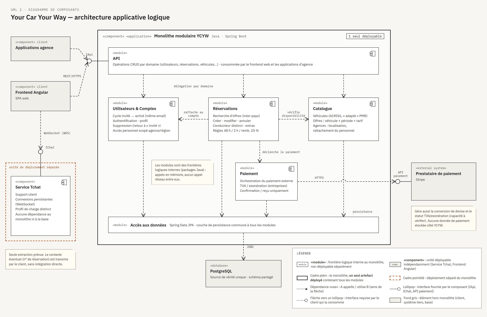
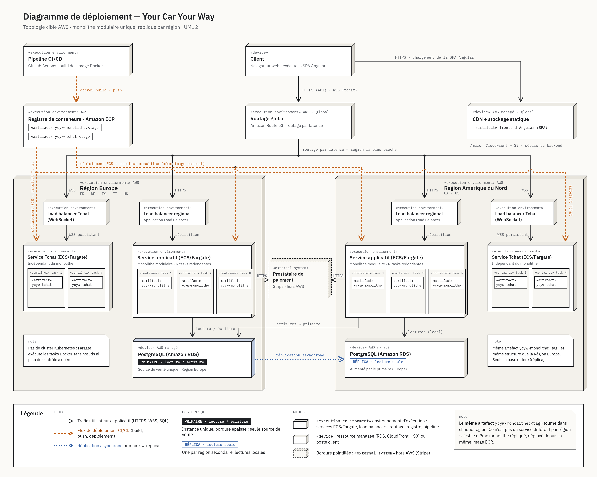
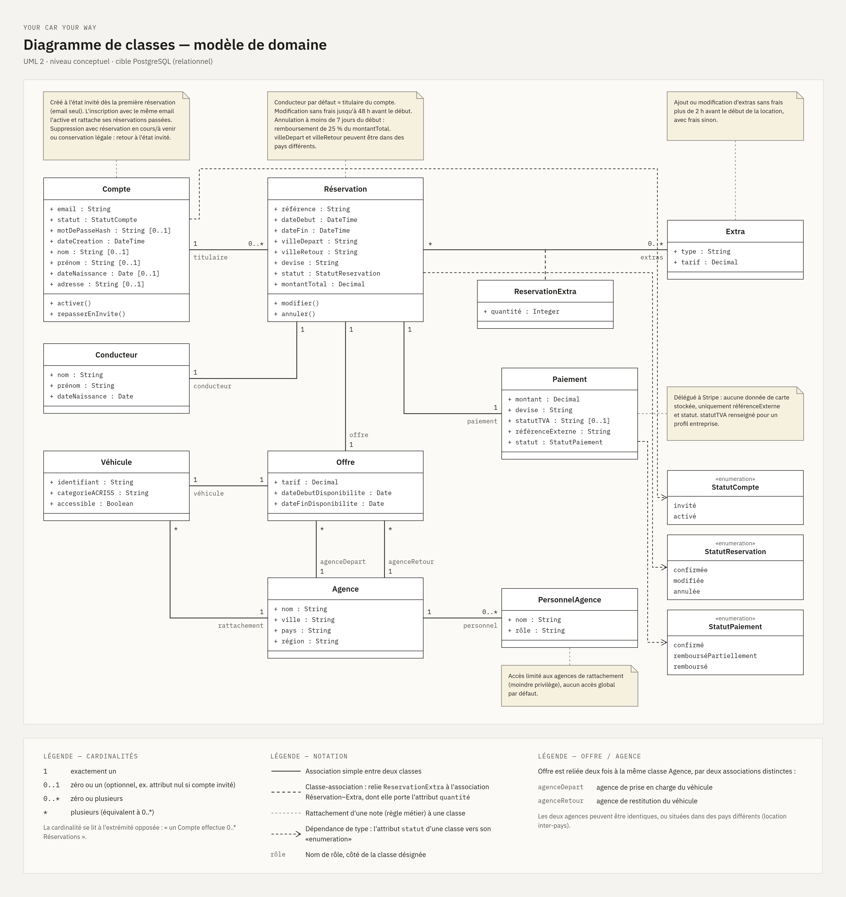

# Proposition d'architecture — Your Car Your Way (brouillon de travail)

> Document de travail, livrable 2. Rempli progressivement (AU01 → AU04, puis AR01 → AR04).

## 1. Audit de l'existant

### 1.1 Cartographie de l'architecture existante (AU01)

**Par pays**

| Pays | Backend | Frontend | Hébergement | Architecture | Particularité |
|---|---|---|---|---|---|
| FR (historique) | Java EE | JSP/JSF | OVH, déploiement manuel | Monolithe complet (auth, catalogue, réservation, paiement) | Base technique la plus ancienne ; socle des déclinaisons DE/ES/IT |
| DE/ES/IT | Java EE (dérivé FR) | JSP/JSF | OVH | Monolithe | Code copié/adapté → divergence progressive, règles métier parfois différentes d'un pays à l'autre |
| UK | PHP Laravel | — | AWS EC2 classique | Monolithe | Issue d'un rachat, isolée, modèle de données et règles de réservation différents |
| CA | Node.js | React | AWS | Monolithe (backend) | Tentative de modernisation UX, jamais généralisée aux autres pays |
| US | Spring Boot | Angular | Azure (containers) | Monolithe, mais seule application containerisée | Projet le plus ambitieux techniquement, jamais généralisé |

**Architecture globale**

- 100 % monolithes web — aucun microservice, sur aucun des 4 systèmes.
- APIs limitées, hétérogènes, non unifiées entre pays.
- Chaque pays possède sa propre base de données, avec un schéma divergent — pas de partage de données automatisé entre systèmes.
- Conséquence directe : 4 silos technologiques indépendants, sans garantie de cohérence fonctionnelle entre eux (fonctionnalités divergentes DE/ES/IT, modèle de données et règles de réservation propres au UK).

### 1.2 Critères d'audit (AU02)

*Liste ouverte, à consolider une fois tous les critères passés en revue — un même constat peut servir plusieurs critères à la fois (ex. maintenabilité et fiabilité se recoupent sur ce système).*

**Maintenabilité** : la capacité du système à être compris, corrigé et fait évoluer dans le temps, sans introduire de régressions ni de divergences entre les différentes versions/déploiements.

**Performance** : la capacité du système à traiter un volume de requêtes donné rapidement et sans dégradation, notamment sous charge.

**Disponibilité** : la proportion du temps pendant laquelle le système est accessible aux utilisateurs, toutes causes d'indisponibilité confondues (incidents et maintenance planifiée).

**Fiabilité** : la capacité du système à fonctionner sans défaillance imprévue et à se rétablir rapidement et correctement lorsqu'un incident survient.

**Évolutivité** : la capacité du système à accueillir de nouvelles fonctionnalités, de nouveaux marchés, et une charge croissante, sans nécessiter une refonte complète.

**Sécurité** : la capacité du système à protéger les données et les accès contre les menaces (accès non autorisé, interception, exploitation de vulnérabilités connues), au moyen de mécanismes de protection éprouvés et à jour.

### 1.3 Audit détaillé (AU03)

**Maintenabilité**
- Code source DE/ES/IT "souvent copié/adapté" depuis le socle FR, entraînant une divergence progressive et des règles métier parfois différentes d'un pays à l'autre — évolution non maîtrisée du code au fil du temps.
- Taux de réussite des déploiements : 82 % sur OVH (déploiements manuels) contre 91 % sur cloud (UK/CA/US) — un système difficile à faire évoluer sans erreur.
- Délai moyen de stabilisation après mise à jour : 3,4 jours (OVH) contre 1,7 jour (cloud) — cohérent avec un système plus difficile à corriger une fois un problème détecté.
- *(Ces deux dernières statistiques recoupent également le critère Fiabilité — se référer à cette section plutôt que de dupliquer l'analyse.)*

**Performance**
- Charge maximale sans dégradation : ≈150 req/s (FR/DE/ES/IT) contre 250 à 350 req/s (UK/CA/US) — le socle historique supporte quasiment deux fois moins de trafic.
- Taux d'erreur lors des pics de trafic saisonniers : jusqu'à 4 % (FR/DE/ES/IT) contre 0,8 à 1,5 % (UK/CA/US) — le système historique se dégrade nettement plus sous charge.

**Disponibilité**
- Taux de disponibilité moyen (12 mois) : 97,2 % (FR/DE/ES/IT) contre 98,6-98,9 % (UK/CA/US) — écart cohérent avec des déploiements manuels/une maintenance plus lourde sur OVH (cf. Maintenabilité).
- Redondance : aucune réplication des instances applicatives (FR/DE/ES/IT) contre réplication partielle (UK/CA) et application containerisée mais base non redondante (US) — absence de redondance = exposition plus forte en cas de panne matérielle.
- ⚠️ **Incohérence des chiffres à vérifier avec le mentor** : le taux de 97,2 % implique environ 20h d'indisponibilité mensuelle, très supérieur aux 21-28 minutes/mois indiquées plus bas (Fiabilité). Hypothèse retenue pour ce brouillon : le taux de disponibilité inclut les interruptions planifiées (maintenance, déploiements), alors que le chiffre en minutes ne couvre que les incidents non planifiés. À confirmer.

**Fiabilité**
- Temps moyen d'indisponibilité mensuel (incidents non planifiés, cf. hypothèse ci-dessus) : 21 à 28 min (FR/DE/ES/IT) contre 7 à 16 min (UK/CA/US).
- MTTR (temps de récupération après incident) : 2h45 (OVH) contre 1h10 (AWS/Azure) — une fois un incident survenu, deux fois plus de temps pour y remédier sur l'infrastructure historique.
- Sauvegardes : manuelles, quotidiennes, restauration non testée (FR/DE/ES/IT) contre snapshots quotidiens non testés (UK/CA) contre sauvegardes automatisées avec test de restauration tous les 90 jours (US) — capacité de récupération après perte de données très inégale ; l'existant historique présente le risque le plus élevé (sauvegarde jamais testée = fiabilité de récupération non prouvée).

**Évolutivité**
- L'architecture est monolithique, ce qui n'est pas en soi un problème si le monolithe est bien structuré. Mais rien dans l'existant ne l'indique : le code copié/adapté entre pays, l'absence d'API interne et les schémas de données divergents suggèrent au contraire un manque de modularité — c'est ce manque de structuration, et non le choix du monolithe en lui-même, qui limite l'évolutivité actuelle.
- Aucune base de données ou API commune entre pays : chaque marché est un silo isolé, sans fondation partagée sur laquelle étendre le système.
- Tentatives d'évolution passées non généralisées : le Canada (React/Node, "première tentative d'unification visuelle, restée locale") et les États-Unis (seule application containerisée, "projet plus ambitieux, jamais généralisé") montrent que même les efforts de modernisation n'ont jamais dépassé le cadre d'un seul pays.
- Scalabilité d'infrastructure : seule l'application US est containerisée — les 4 autres nécessiteraient une refonte d'infrastructure, pas seulement une configuration, pour absorber une charge croissante.

**Sécurité**
- Hashage des mots de passe : SHA-1 (FR/DE/ES/IT) — algorithme déprécié pour cet usage depuis plus d'une décennie, cassable avec du matériel courant — contre bcrypt/argon2id (UK/CA/US), standards actuels recommandés. *(à vérifier)*
- Chiffrement du trafic : TLS 1.0 toujours utilisé (FR, IT) — protocole officiellement déprécié (RFC 8996, 2021), vulnérable à des attaques connues (BEAST, POODLE), abandonné par les navigateurs majeurs depuis 2020. *(à vérifier)*
- Gestion des secrets : secrets stockés en fichiers de configuration sur serveur (FR/DE/ES/IT), sans rotation ni contrôle d'accès dédié — contre des approches plus structurées mais encore incomplètes ailleurs (variables d'environnement sans rotation sur UK/CA, KeyVault partiel sur US).
- Dépendances vulnérables : 35-41 % des paquets (FR/DE/ES/IT) contre 11-22 % (UK/CA/US) — la plus grande surface d'exposition à des vulnérabilités déjà documentées.

### 1.4 Conclusion (AU04)

| Critère | Verdict | Justification courte |
|---|---|---|
| Maintenabilité | **Non validé** | Divergence par copier/adapter entre pays, faible taux de réussite des déploiements (82 %), stabilisation lente (3,4 j). |
| Performance | **Non validé** (socle historique) | FR/DE/ES/IT supportent ~150 req/s contre 250-350 ailleurs ; même les systèmes les plus récents montrent une dégradation non nulle sous pic (0,8-1,5 %). |
| Disponibilité | **Partiellement validé, mais fragile** | Les taux affichés (97,2-98,9 %) semblent corrects en façade, mais l'absence totale de redondance (FR/DE/ES/IT) en fait un résultat non robuste : un seul incident matériel suffirait à dégrader fortement ce chiffre. |
| Fiabilité | **Non validé** | MTTR deux fois plus long sur l'infrastructure historique (2h45 vs 1h10), sauvegardes jamais testées (FR/DE/ES/IT, UK/CA) — la capacité de récupération n'est démontrée nulle part de façon robuste, pas même sur US (test tous les 90 jours seulement). |
| Évolutivité | **Non validé, sur aucun des 4 systèmes** | Même les tentatives de modernisation (CA, US) ne sont jamais sorties du périmètre d'un seul pays ; absence totale de socle de données ou d'API partagé entre marchés. |
| Sécurité | **Non validé (historique) / partiellement validé (récent)** | FR/DE/ES/IT cumulent les pratiques dépréciées (SHA-1, TLS 1.0, secrets non gérés, 35-41 % de dépendances vulnérables) ; UK/CA/US suivent de meilleures pratiques mais gardent des lacunes (pas de rotation des secrets, KeyVault partiel). |

**Synthèse** : aucun des quatre systèmes existants ne satisfait pleinement les critères retenus. Le socle historique (FR/DE/ES/IT) échoue sur la quasi-totalité d'entre eux. Les systèmes plus récents (UK, CA, US) se comportent nettement mieux sur les critères opérationnels (performance, disponibilité, fiabilité, sécurité), mais échouent eux aussi sur le critère le plus déterminant pour cette mission — l'évolutivité : aucun n'a jamais réussi à s'étendre au-delà d'un seul pays, faute de socle de données ou d'API partagé. Cela confirme qu'il ne s'agit pas de corriger ou d'étendre l'un des systèmes actuels, mais de concevoir une architecture cible commune, pensée dès le départ pour l'ensemble des marchés.

---

## 2. Spécifications techniques et architecture cible (AR01 → AR04)

### 2.1 Spécifications techniques (AR01)

**Authentification et comptes**
- Système de création de compte / connexion / récupération de mot de passe (absent de l'existant, cf. cahier des charges §1).
- Modèle de compte "invité → activé" : un enregistrement lié à l'email existe dès la première réservation, devient un compte complet lors de l'inscription avec le même email.
- Suppression de compte : ramène le compte à l'état "invité" si une réservation est en cours/à venir ou si des données doivent être légalement conservées, plutôt qu'une suppression totale.

**Internationalisation**
- Recherche et réservation inter-pays (ville de départ ≠ pays de la ville de retour).
- Devise déterminée par le pays de la ville de départ ; conversion déléguée au prestataire de paiement.
- Interface multilingue (socle FR/EN/DE/ES/IT), conçue pour permettre l'ajout de langues sans refonte.

**Accessibilité**
- Conformité aux standards d'accessibilité (WCAG/RGAA) sur l'ensemble du parcours : navigation clavier, compatibilité lecteur d'écran, structure sémantique.

**Sécurité** *(directement informé par l'audit, §1.3)*
- Hashage des mots de passe avec un algorithme moderne (argon2id ou bcrypt) — jamais SHA-1.
- TLS 1.2 minimum (idéalement 1.3) uniquement — pas de support legacy TLS 1.0.
- Gestion des secrets via un mécanisme dédié avec rotation (pas de secrets en fichier de configuration).
- Scan de vulnérabilités des dépendances intégré au pipeline (pas de contrôle ponctuel seulement).
- Aucune collecte/stockage de pièce d'identité ou permis de conduire — vérification physique en agence.
- Accès du personnel d'agence scopé par région/agence (moindre privilège).

**Données et architecture globale**
- Un socle de données logiquement unifié (remplace les 4 schémas divergents actuels) — condition nécessaire à la recherche/réservation inter-pays et à l'évolutivité (cf. audit AU04).
- Les données (comptes, réservations, catalogue véhicules/offres) doivent rester accessibles globalement, quelle que soit la région de l'utilisateur ou du serveur qui traite la requête — la distribution géographique des serveurs ne doit pas fragmenter les données en silos régionaux (cf. discussion §2.1 ci-dessus).

**API**
- API exposant les données (utilisateurs, réservations, véhicules...) avec opérations CRUD par domaine, pour les applications utilisées en agence (déjà requis au cahier des charges).

**Paiement et fiscalité**
- Paiement intégralement délégué à un prestataire externe (Stripe) — aucune donnée de paiement stockée.
- Statut de TVA/exonération pour les profils entreprise, pris en charge nativement par le prestataire (Stripe Tax — à vérifier).
- Aucun moteur de facturation interne — reçu de paiement standard pour tous les profils.

**Fiabilité et disponibilité** *(informé par l'audit, §1.3)*
- Redondance des instances applicatives (pas de point de défaillance unique, contrairement à l'existant FR/DE/ES/IT).
- Sauvegardes automatisées et testées régulièrement (contrairement à l'existant, jamais testé sur le socle historique).
- Déploiements automatisés (CI/CD) — remplace les déploiements manuels, identifiés comme cause probable du faible taux de réussite des déploiements et du MTTR élevé de l'existant.

**Performance et évolutivité** *(informé par l'audit, §1.3, et par la discussion sur la charge combinée)*
- Infrastructure conçue pour le scaling horizontal (containerisation), contrairement à l'existant (1 seule application containerisée sur 4).
- Capacité à absorber une charge significativement supérieure à celle de n'importe quel système actuel pris isolément, sans nécessiter la somme brute des pics de chaque marché (les marchés ne sont pas supposés être simultanément au pic).
- Architecture pensée dès le départ pour accueillir de nouveaux marchés/fonctionnalités sans refonte complète.

### 2.2 Choix technologiques (AR02)

**Critères d'évaluation, par ordre de priorité**

1. **Adéquation fonctionnelle et technique** (priorité la plus haute) : la solution répond-elle aux spécifications de l'AR01 et corrige-t-elle les faiblesses identifiées à l'audit (§1.3) — API-first/données unifiées, accessibilité, i18n, scalabilité horizontale, sécurité, CI/CD ?
2. **Contraintes organisationnelles** (secondaires, départagent entre options par ailleurs proches) : compétences déjà présentes dans l'équipe, coût, réutilisation d'un fournisseur cloud déjà en place.

**Justification de cet ordre** : l'audit montre que l'organisation est déjà capable d'adopter une stack entièrement nouvelle avec succès (US : Angular/Spring Boot/Azure, containerisé — seule application de l'existant à l'être). La familiarité de l'équipe avec une technologie n'est donc pas un facteur bloquant ; elle ne doit faire pencher la balance qu'entre deux options par ailleurs équivalentes sur le plan technique.

**Style d'architecture**

Option retenue : **monolithe modulaire structuré selon les principes du Domain-Driven Design (DDD)** — une application unique en déploiement, mais strictement découpée en modules de domaine (ex. Utilisateurs, Réservations, Catalogue véhicules, Paiement), avec des frontières explicites entre modules.

Alternatives écartées :
- **Microservices** : complexité opérationnelle (orchestration, observabilité distribuée, cohérence transactionnelle inter-services) disproportionnée par rapport à la taille de l'équipe et au périmètre fonctionnel ; l'audit ne révèle aucune limite de l'existant qui nécessiterait ce niveau de granularité.
- **Serverless** : mauvais ajustement pour une charge soutenue et prévisible (réservations, paiement) plutôt que des pics ponctuels isolés ; complique la gestion d'état et les transactions multi-étapes du parcours de réservation.

Justification : l'audit (§1.3) attribue les faiblesses de maintenabilité et d'évolutivité de l'existant non pas au style « monolithe » en tant que tel, mais à l'absence de modularité interne (code copié/adapté entre pays, aucune API interne, schémas de données divergents). Un monolithe modulaire DDD corrige directement cette cause racine, sans ajouter la complexité opérationnelle des microservices.

**Choix du langage/framework backend**

Candidats évalués : Java + Spring Boot, .NET / C# (ASP.NET Core), Node.js + NestJS (TypeScript), PHP + Laravel, Python + Django — les technologies déjà présentes dans l'existant (Spring Boot, Laravel, l'équivalent Node de NestJS), complétées par deux alternatives absentes du parc actuel (.NET, Django), pour ne pas limiter la comparaison aux seuls choix hérités.

Méthode : notation de 1 (mauvais) à 10 (excellent) par critère, sur l'adéquation technique pure — la compétence déjà présente dans l'équipe est traitée séparément, en tant que critère de priorité 2 (départage uniquement entre options techniquement proches). Pour limiter le risque de biais de confirmation, la notation a été réalisée deux fois indépendamment : une première fois en interne, une seconde par un agent IA sans connaissance préalable du projet ni des scores déjà obtenus. Les deux évaluations convergent sur le classement :

| Critère | Spring Boot | .NET | NestJS | Laravel | Django |
|---|---|---|---|---|---|
| Modularité / DDD | 9 | 8 | 8 | 4 | 4 |
| Support i18n | 9 | 9 | 5 | 8 | 9 |
| Hashage de mot de passe moderne | 9 | 7 | 5 | 9 | 8 |
| Maturité | 9 | 8 | 5 | 7 | 9 |
| Typage statique | 10 | 10 | 8 | 3 | 3 |
| Modèle de concurrence (charge I/O-bound) | 7 | 9 | 9 | 5 | 5 |
| ORM / accès aux données | 9 | 9 | 5 | 10 | 10 |
| **Total /70** | **62** | **60** | **45** | **46** | **48** |

Point de vigilance documenté : le critère « modularité/DDD » ne distingue pas d'outillage DDD strict dans tous les frameworks — un développeur expérimenté peut structurer proprement n'importe lequel d'entre eux par seule discipline (c'est notamment le cas de Django, dont les « apps » permettent une bonne modularité si les conventions sont suivies). Le choix privilégie malgré tout les mécanismes imposés/outillés nativement par le framework plutôt que la discipline d'équipe seule, précisément parce que l'audit (§1.3) montre que l'absence d'un tel garde-fou est ce qui a produit la divergence de code dans l'existant.

**Décision : Java + Spring Boot.**

Justification : meilleur score sur les deux évaluations indépendantes, cohérent avec la priorité 1 (adéquation technique). Sur le critère secondaire (priorité 2, compétences déjà présentes) : l'équipe US a déjà shippé en production sur Spring Boot/Angular/Azure containerisé — seule application de l'existant containerisée — ce qui confirme à la fois une compétence déjà disponible sur ce choix et la capacité de l'organisation à adopter une nouvelle stack avec succès.

**Choix de la base de données**

Modèle de données retenu : **relationnel**. Le cœur du domaine (utilisateurs, réservations, véhicules, agences, paiements) a des besoins de cohérence transactionnelle stricts (pas de double réservation, pas de paiement orphelin) qui correspondent directement aux garanties ACID. Un SGBD NoSQL (document/clé-valeur) est écarté comme système de référence : sa flexibilité de schéma referait courir le risque exact identifié à l'audit (§1.3) — des structures de données divergentes d'un pays à l'autre, faute de schéma commun imposé. Cela n'exclut pas d'introduire, plus tard, un outil non relationnel complémentaire pour un besoin ponctuel (cache, recherche plein texte dédiée) — mais pas en remplacement du système de référence.

Candidats évalués : PostgreSQL, MySQL/MariaDB, Microsoft SQL Server, Oracle Database.

Méthode : même protocole que pour le choix du backend — notation indépendante interne, puis par un agent IA sans connaissance préalable du projet, sur le mérite technique pur (le coût de licence est traité séparément ci-dessous, en tant que critère de priorité 2). Les deux évaluations convergent sur le vainqueur :

| Critère | PostgreSQL | MySQL/MariaDB | SQL Server | Oracle |
|---|---|---|---|---|
| ACID / intégrité transactionnelle | 9 | 7 | 9 | 10 |
| Réplication régionale (réplicas en lecture) | 8 | 9 | 7 | 9 |
| Écosystème Spring Boot (Hibernate/Spring Data JPA) | 10 | 9 | 7 | 6 |
| Maturité / fiabilité générale | 9 | 9 | 9 | 10 |
| Richesse des types natifs (JSON, géospatial, full-text) | 10 | 6 | 8 | 8 |
| **Total /50** | **46** | **40** | **40** | **43** |

Points de vigilance documentés : le classement MySQL/MariaDB suppose InnoDB en mode strict (configuration moderne par défaut) — sous des réglages hérités plus permissifs, son score ACID serait plus bas. Le critère de réplication régionale est le plus débattu des cinq : MySQL reste historiquement la solution la plus simple et la plus éprouvée pour démultiplier des réplicas en lecture à grande échelle, Oracle Data Guard la plus complète mais la plus lourde à opérer, PostgreSQL la plus flexible mais avec quelques aspérités sur la réplication logique — un autre expert pourrait pondérer cet ordre différemment.

Critère organisationnel (priorité 2, coût de licence) : PostgreSQL et MySQL/MariaDB sont open source et gratuits ; SQL Server facture par cœur à l'échelle, et Oracle est la licence la plus coûteuse du marché pour un déploiement entreprise. Ce critère renforce le choix technique plutôt que de le contredire.

**Décision : PostgreSQL.**

Justification : meilleur score sur les deux évaluations indépendantes, meilleur support natif de l'écosystème Spring Data JPA/Hibernate, types natifs (JSON, géospatial, full-text) directement pertinents pour le catalogue véhicule et la localisation des agences, et gratuit/open source — cohérent avec le choix déjà fait pour le backend (Spring Boot, également open source).

**Choix du framework frontend**

Candidats évalués : Angular, React (+ Next.js pour le SSR), Vue.js (+ Nuxt), Svelte (+ SvelteKit). Ember.js a été considéré puis écarté sans notation : philosophie structurante comparable à Angular, mais communauté et bassin de recrutement en déclin marqué ces dernières années. VanillaJS/jQuery a également été considéré puis écarté : aucune convention de structure, d'accessibilité ni d'i18n native, ce qui reproduirait précisément le risque de divergence identifié à l'audit (§1.3).

Critères (mêmes principes que pour le backend : adéquation technique d'abord, compétences d'équipe en départage secondaire) :
1. Accessibilité (WCAG/RGAA) — exigence transverse forte et légalement engageante (§2 AN02).
2. Internationalisation (i18n).
3. Structure imposée / maintenabilité — un framework qui impose une architecture limite le risque de divergence entre équipes pays, à l'image du raisonnement déjà tenu pour le backend (DDD/Spring Modulith).
4. Flexibilité de rendu (SSR/SSG/CSR) — pages publiques (recherche, catalogue) vs parcours authentifié type application.
5. Maturité / écosystème.

Méthode : même protocole double évaluation (interne + agent IA indépendant) que pour le backend et la base de données.

| Critère | Angular | React/Next.js | Vue/Nuxt | Svelte/SvelteKit |
|---|---|---|---|---|
| Accessibilité (WCAG/RGAA) | 9 / 8 | 8 / 9 | 7 / 6 | 8 / 7 |
| i18n | 9 / 7 | 8 / 9 | 8 / 9 | 6 / 5 |
| Structure imposée / maintenabilité | 9 / 10 | 5 / 6 | 7 / 7 | 7 / 6 |
| Flexibilité de rendu SSR/SSG/CSR | 7 / 7 | 10 / 10 | 9 / 9 | 9 / 8 |
| Maturité / écosystème | 9 / 8 | 10 / 10 | 8 / 8 | 6 / 5 |
| **Total /50 (interne / agent indépendant)** | **43 / 40** | **41 / 44** | **39 / 39** | **36 / 31** |

Contrairement au backend et à la base de données, les deux évaluations indépendantes ne convergent pas sur un vainqueur net : Angular l'emporte dans la notation interne, React/Next.js dans la notation indépendante. L'écart se concentre sur deux critères :
- **Accessibilité** : outillage officiel mais plus restreint (Angular CDK) contre écosystème de composants plus riche et éprouvé mais non officiel (React Aria, Radix).
- **i18n** : outillage officiel mais plus rigide (`@angular/localize`) contre bibliothèque non officielle mais de facto standard et plus mature en pratique (`ngx-translate`, `next-intl`, `vue-i18n`).

Un sixième critère (performance / poids du runtime) a été testé pour tenter de départager les deux options, mais a été écarté de la décision finale : jugé trop dépendant de choix de configuration ultérieurs (Angular zoneless vs zone.js, React Server Components vs hydratation classique par les deux évaluations elles-mêmes) pour servir de critère décisif. Il est documenté ici pour traçabilité mais ne compte pas dans le total ci-dessus : Angular 5/3, React/Next.js 7/5, Vue/Nuxt 8/7, Svelte/SvelteKit 10/9 (interne / agent indépendant).

**Décision : Angular.**

Justification : face à un désaccord réel entre les deux évaluations, l'arbitrage s'est fait sur le critère qui rejoint directement le diagnostic de l'audit (§1.3) — un chemin unique, imposé par le framework, réduit le risque qu'une équipe pays choisisse une bibliothèque tierce de qualité inégale (en accessibilité comme en i18n), plutôt que de multiplier les bonnes options disponibles mais non garanties. C'est le même raisonnement qui a guidé le choix du backend (Spring Modulith) et de la base de données (contraintes relationnelles plutôt que flexibilité de schéma) : privilégier un garde-fou outillé par le framework plutôt que la seule discipline d'équipe, précisément parce que l'absence d'un tel garde-fou est ce qui a produit la divergence dans l'existant.

**Choix de conteneurisation / orchestration**

Décidé indépendamment du choix d'hébergement (pour ne pas biaiser l'un par l'autre), puis vérifié a posteriori pour cohérence.

Candidats évalués : (A) VMs + automatisation infra-as-code (Ansible/Terraform), sans conteneurs ; (B) conteneurs Docker + orchestrateur Kubernetes complet ; (C) conteneurs Docker + plateforme de conteneurs managée sans gestion de cluster (catégorie générique : AWS Fargate/ECS, Google Cloud Run, Azure Container Apps) ; (D) PaaS (déploiement par artefact, type Elastic Beanstalk/App Service).

Critères : (1) adéquation avec un monolithe modulaire à déploiement unique — éviter de sur-outiller pour un problème multi-services qu'on n'a pas ; (2) résolution directe de la faiblesse d'audit (déploiements manuels/fragiles, §1.3) ; (3) complexité opérationnelle pour une équipe restreinte, sans organisation SRE/plateforme dédiée ; (4) portabilité / évitement du lock-in ; (5) capacité d'évolution future (extraction d'un service indépendant) ; (6) maturité/écosystème ; (7) réplication multi-région du même artefact — le besoin réel du projet : non pas scinder le monolithe en plusieurs services, mais déployer la même unité applicative en plusieurs exemplaires indépendants par région, chacun connecté à la même source de vérité PostgreSQL (avec ses réplicas de lecture déjà décidés).

| Critère | A. VMs + IaC | B. Docker + Kubernetes | C. Conteneurs managés sans cluster | D. PaaS |
|---|---|---|---|---|
| Adéquation monolithe mono-déploiement | 6 / 7 | 4 / 2 | 9 / 9 | 8 / 9 |
| Résolution de la faiblesse de l'audit | 6 / 6 | 9 / 8 | 9 / 9 | 8 / 8 |
| Complexité opérationnelle (équipe restreinte) | 5 / 6 | 3 / 2 | 9 / 9 | 9 / 9 |
| Portabilité / évitement du lock-in | 7 / 7 | 9 / 9 | 5 / 6 | 3 / 4 |
| Capacité d'évolution future | 4 / 4 | 9 / 9 | 7 / 8 | 6 / 4 |
| Maturité / écosystème | 8 / 9 | 9 / 9 | 7 / 8 | 8 / 8 |
| Réplication multi-région du même artefact | 7 / 6 | 5 / 5 | 10 / 9 | 8 / 7 |
| **Total /70 (interne / agent indépendant)** | **43 / 45** | **48 / 44** | **56 / 58** | **50 / 49** |

Les deux évaluations convergent nettement sur l'option C, avec un écart qui se creuse à mesure que les critères sont ajoutés. Kubernetes (B) est explicitement écarté non pas pour un manque de maturité — il reste l'option la plus portable et la mieux outillée pour une évolution future vers des services indépendants — mais parce qu'il répond à un problème de scalabilité multi-services que ce projet n'a pas, au prix d'une charge opérationnelle (gestion de cluster, mises à jour, réseau, RBAC) que l'équipe n'a pas vocation à porter.

**Décision : conteneurs Docker sur une plateforme de conteneurs managée sans gestion de cluster** (AWS Fargate/ECS, concrètement, compte tenu du choix d'hébergement ci-dessous).

Note d'architecture : ce choix n'empêche pas d'extraire, dès le départ et pour des raisons techniques justifiées (et non par principe), un service réellement indépendant lorsque le besoin l'exige — notamment la fonctionnalité de tchat (étape 4), dont le modèle de connexions persistantes (WebSocket) et le profil de charge diffèrent nettement du reste du monolithe. La plateforme retenue gère nativement plusieurs services indépendants sans nécessiter l'outillage complet de Kubernetes.

**Choix de la plateforme d'hébergement**

Candidats évalués : AWS, Microsoft Azure, Google Cloud Platform, OVHcloud. Scaleway a été considéré puis écarté sans notation : pas de présence en Amérique du Nord, ce qui disqualifie d'emblée le besoin de couverture géographique double (critère 1).

Critères :
1. Couverture géographique (Europe + Amérique du Nord) — nécessaire pour les réplicas régionaux déjà décidés pour PostgreSQL.
2. Service PostgreSQL managé.
3. Conformité réglementaire / certifications (RGPD, résidence des données — point « à vérifier » noté en AN02/AR01).
4. Maturité des plateformes de conteneurs serverless (sans gestion de cluster) — corrige directement la faiblesse de déploiements manuels/fragiles identifiée à l'audit (§1.3). *(Critère reformulé après coup : la première version demandait la maturité Kubernetes managé, avant que le choix d'orchestration — ci-dessous — n'écarte explicitement Kubernetes au profit d'une plateforme de conteneurs serverless sans cluster. Les deux évaluations ont été refaites sur la bonne base.)*
5. Maturité / part de marché générale.

OVHcloud a été noté sur ses mérites techniques actuels comme les autres candidats, sans pénalité liée à son association avec le système FR historique — l'audit a déjà établi que c'était l'absence de modularité et d'automatisation du déploiement qui posait problème, pas la plateforme d'hébergement en tant que telle.

| Critère | AWS | Azure | GCP | OVHcloud |
|---|---|---|---|---|
| Couverture géographique | 10 / 10 | 10 / 9 | 8 / 8 | 7 / 5 |
| Service PostgreSQL managé | 10 / 10 | 9 / 8 | 8 / 8 | 6 / 4 |
| Conformité réglementaire / certifications | 9 / 9 | 9 / 9 | 8 / 8 | 9 / 8 |
| Maturité plateformes conteneurs serverless | 9 / 9 | 6 / 6 | 9 / 9 | 4 / 2 |
| Maturité / part de marché générale | 10 / 10 | 9 / 9 | 8 / 7 | 6 / 4 |
| **Total /50 (interne / agent indépendant)** | **48 / 48** | **43 / 41** | **41 / 40** | **32 / 23** |

Les deux évaluations convergent sur le même classement : AWS en tête, Azure second, GCP troisième, OVHcloud dernier — la correction du critère 4 a même renforcé l'avance d'AWS plutôt que de la réduire (Azure Container Apps n'est en disponibilité générale que depuis 2022, OVHcloud n'a pas d'offre dédiée réellement comparable dans cette catégorie précise). Point de vigilance documenté par l'agent indépendant sur le critère de conformité (ligne 3) : le score d'OVHcloud dépend fortement de la pondération choisie entre « nombre de certifications » (pénalisant, 5-6) et « souveraineté des données / absence d'exposition au CLOUD Act américain » (favorable, pourrait dépasser AWS/Azure) — cela ne change pas le classement global.

Critère organisationnel (priorité 2) :

| | AWS | Azure | GCP | OVHcloud |
|---|---|---|---|---|
| Coût | 6 — tarification complexe, frais de sortie élevés | 6 — comparable à AWS | 7 — compute généralement un peu moins cher | 9 — nettement moins cher, notamment sur la sortie de données |
| Compétences déjà dans l'équipe | 9 — utilisé en production (UK, CA) | 9 — utilisé en production (US, seule application containerisée de l'existant) | 1 — aucun historique | 7 — utilisé en production (FR), sur le système jugé le plus faible à l'audit |

Le critère organisationnel ne renverse pas le classement technique : l'avantage de coût et de simplicité d'OVHcloud ne compense pas son retard technique sur la couverture géographique, le service PostgreSQL managé et l'outillage CI/CD/Kubernetes.

**Décision : AWS.**

Justification : meilleur score sur les deux évaluations indépendantes, et seul le classement est resté identique entre les deux (contrairement au choix du framework frontend) — signal de robustesse plus fort. Déjà utilisé en production sur deux des quatre systèmes existants (UK, CA), ce qui confirme une compétence déjà disponible en interne.

### 2.3 Modélisation UML (AR03)

Conformément à la recommandation de la mission (« Utilisez des diagrammes UML adaptés (composants, déploiement, classes) »), trois diagrammes ont été produits, chacun reprenant directement les décisions actées en §2.2 (AR02).

**Diagramme de composants**

Illustre le découpage interne du monolithe modulaire DDD (modules Utilisateurs & Comptes, Réservations, Catalogue, Paiement, Accès aux données), exposés via un module API consommé par le frontend Angular et les applications d'agence. Montre explicitement que le Service Tchat est la seule extraction en service indépendant, sans dépendance au monolithe ni à la base de données — cohérent avec le choix de conteneurisation (§2.2).

**Diagramme de déploiement**

Illustre la topologie AWS cible : le même artefact applicatif (monolithe) déployé en plusieurs instances redondantes dans deux régions (Europe, Amérique du Nord), derrière un routage global à latence minimale (Amazon Route 53), sur des conteneurs managés sans cluster (Fargate/ECS) — conforme aux choix d'hébergement et de conteneurisation (§2.2). Un seul socle PostgreSQL fait autorité (primaire en Europe, réplica en lecture en Amérique du Nord), le frontend Angular est servi indépendamment via un CDN (CloudFront + S3), et le déploiement est entièrement automatisé (pipeline GitHub Actions), pour le monolithe comme pour le service Tchat.

**Diagramme de classes**

Modélise le domaine métier central (Compte, Réservation, Conducteur, Offre, Véhicule, Agence, Extra, Paiement, PersonnelAgence) et les règles métier actées au cahier des charges (mécanisme invité/activé, conducteur distinct du réservataire, réservation inter-pays via deux rôles d'agence départ/retour, délais de modification/annulation, remboursement partiel). Sert de base au modèle de données relationnel détaillé en §2.4 (AR04).

### 2.4 Modèle de données (AR04)

Traduction directe du diagramme de classes (§2.3) en schéma relationnel PostgreSQL. Convention : identifiants techniques en `BIGSERIAL` (non représentés sur le diagramme conceptuel, nécessaires au niveau physique), noms de tables/colonnes en `snake_case`, un seul schéma partagé par l'ensemble des marchés — conformément à l'exigence d'un socle de données unifié (§2.1 AR01, §1.4 AU04). La réplication régionale en lecture (primaire Europe / réplica Amérique du Nord) a déjà été actée en §2.2 (AR02) et n'est pas reprise ici — ce schéma est celui appliqué sur l'instance primaire, répliqué tel quel.

**Comptes et personnel**

| Table | Colonnes | Clés / contraintes |
|---|---|---|
| `compte` | `id`, `email`, `statut` (`statut_compte`), `mot_de_passe_hash` (nul), `date_creation`, `nom` (nul), `prenom` (nul), `date_naissance` (nul), `adresse` (nul) | PK `id` ; `email` UNIQUE NOT NULL ; `mot_de_passe_hash`/`nom`/`prenom`/`date_naissance`/`adresse` nuls tant que `statut = 'invite'` |
| `agence` | `id`, `nom`, `ville`, `pays`, `region` | PK `id` |
| `personnel_agence` | `id`, `nom`, `role`, `agence_id` | PK `id` ; FK `agence_id` → `agence(id)` NOT NULL |

**Catalogue**

| Table | Colonnes | Clés / contraintes |
|---|---|---|
| `vehicule` | `id`, `identifiant`, `categorie_acriss`, `accessible` (booléen), `agence_id` | PK `id` ; `identifiant` UNIQUE NOT NULL ; FK `agence_id` → `agence(id)` NOT NULL (rattachement) |
| `offre` | `id`, `vehicule_id`, `agence_depart_id`, `agence_retour_id`, `tarif`, `date_debut_disponibilite`, `date_fin_disponibilite` | PK `id` ; FK `vehicule_id` → `vehicule(id)` NOT NULL ; FK `agence_depart_id` → `agence(id)` NOT NULL ; FK `agence_retour_id` → `agence(id)` NOT NULL (peuvent référencer la même agence ou deux agences différentes, y compris de pays différents) |

**Réservations et extras**

| Table | Colonnes | Clés / contraintes |
|---|---|---|
| `reservation` | `id`, `reference`, `compte_id`, `offre_id`, `paiement_id`, `conducteur_id`, `date_debut`, `date_fin`, `ville_depart`, `ville_retour`, `devise`, `statut` (`statut_reservation`), `montant_total` | PK `id` ; `reference` UNIQUE NOT NULL (accès invité par référence + email) ; FK `compte_id` → `compte(id)` NOT NULL ; FK `offre_id` → `offre(id)` NOT NULL ; FK `paiement_id` → `paiement(id)` UNIQUE NOT NULL ; FK `conducteur_id` → `conducteur(id)` UNIQUE NOT NULL |
| `conducteur` | `id`, `nom`, `prenom`, `date_naissance` | PK `id` — pas de FK vers `compte` : simple snapshot de données saisies à la réservation, pas un profil réutilisable |
| `extra` | `id`, `type`, `tarif` | PK `id` |
| `reservation_extra` | `reservation_id`, `extra_id`, `quantite` | PK composite (`reservation_id`, `extra_id`) ; FK `reservation_id` → `reservation(id)` ; FK `extra_id` → `extra(id)` |

*Point de vigilance documenté* : `ville_depart`/`ville_retour` sont stockées directement sur `reservation` (plutôt que recalculées depuis `offre` → `agence`), en snapshot au moment de la réservation — cohérent avec le diagramme de classes validé. Choix volontaire : la ville affichée sur une réservation passée ne doit pas changer si les données de l'agence associée sont corrigées ultérieurement.

**Paiement**

| Table | Colonnes | Clés / contraintes |
|---|---|---|
| `paiement` | `id`, `montant`, `devise`, `statut_tva` (nul), `reference_externe`, `statut` (`statut_paiement`) | PK `id` ; `reference_externe` UNIQUE NOT NULL (identifiant côté Stripe) ; aucune donnée de carte stockée (délégation intégrale, §2.1 AR01) |

**Énumérations (types PostgreSQL natifs)**

- `statut_compte` : `invite`, `active`
- `statut_reservation` : `confirmee`, `modifiee`, `annulee`
- `statut_paiement` : `confirme`, `rembourse_partiellement`, `rembourse`

**Index recommandés** (usages métier directement identifiés aux user stories, §3 cahier des charges) :
- `compte(email)` — recherche de compte à la connexion et à l'activation.
- `reservation(reference, compte_id)` — accès invité par référence + email, et historique des réservations d'un compte.
- `offre(agence_depart_id, agence_retour_id, date_debut_disponibilite, date_fin_disponibilite)` — recherche d'offre par ville/période (US "Rechercher une offre").
- `vehicule(categorie_acriss, accessible)` — filtre véhicule adapté/catégorie ACRISS.
- `personnel_agence(agence_id)` — application du scope d'accès par agence/région (moindre privilège, §2.1 AR01).
