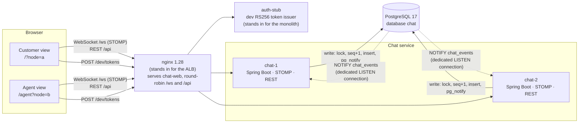

# Your Car Your Way — customer-support chat PoC

[](https://github.com/M0l42/OC-P7-Your_car_your_way/actions/workflows/ci.yml)
[](https://github.com/M0l42/OC-P7-Your_car_your_way/actions/workflows/chaos.yml)

Proof of concept for the customer-support chat of **Your Car Your Way**, a car-rental platform
(OpenClassrooms project 7, step 4). In the target architecture the chat is the one service extracted
from the modular monolith: it holds long-lived WebSocket connections and runs as several independent
containers behind a load balancer. This PoC shows that this design holds up. Two chat instances run
behind nginx, a customer and a support agent talk across them, and **killing the customer's instance
mid-conversation loses, duplicates or reorders nothing**. The client reconnects to the other instance,
reloads what it missed from the database and resends what was not yet acknowledged. A chaos test
checks this with more than 2,000 messages and repeated instance kills.

The architecture deliverables (cahier des charges, architecture proposal, UML diagrams, in French) are
in [`OC-docs_and_livrable/`](OC-docs_and_livrable/).

## Architecture



Each instance keeps an in-memory STOMP broker. A message sent through one instance is committed to
PostgreSQL, and a `NOTIFY` delivered after commit lets every instance load the row and push it to its
own subscribers.

| Choice | Why | Details |
|---|---|---|
| The chat owns its own database (`chat`), with no foreign key to the monolith | Deploy and migrate the extracted service independently; identity comes only from a JWT signed by the monolith (public key in config) | [ADR-001](docs/adr/001-chat-owns-its-database.md) |
| Fan-out through PostgreSQL `LISTEN/NOTIFY` instead of Redis or RabbitMQ | The database already provides the guarantee, so the bus does not need to be durable; no new infrastructure. Limits and the re-open trigger for Redis are documented | [ADR-002](docs/adr/002-fan-out-postgres-listen-notify.md) |
| A gap-free sequence per conversation instead of a global `BIGSERIAL` | A global id can become visible out of commit order and be skipped by a reader; the per-conversation row lock makes seq order equal commit order | [ADR-003](docs/adr/003-per-conversation-sequence.md) |
| STOMP over WebSocket, with an explicit wire contract | Spring idiom on the server and `@stomp/stompjs` on the client; destinations, payloads, error codes and REST shapes are frozen in one document | [docs/protocol.md](docs/protocol.md) |

Stack: Java 21, Spring Boot 4.1, Flyway, PostgreSQL 17, Angular 22, Node 24, nginx 1.28, Docker
Compose, GitHub Actions.

## Data structure

The chat owns one PostgreSQL database, `chat`, with two tables and four enum types:

| File | Content |
|---|---|
| [`V1__chat.sql`](chat-service/src/main/resources/db/migration/V1__chat.sql) | The full schema, applied by Flyway at startup: `conversation`, `message`, the enum types, constraints and indexes |
| [`SchemaConstraintsIT.java`](chat-service/src/test/java/com/ycyw/chat/SchemaConstraintsIT.java) | Tests the constraints against a real PostgreSQL |
| [`01-chat-database.sql`](infra/postgres/init/01-chat-database.sql) | Dev-only bootstrap of the `chat` database and its owner role |

The schema implements the Service Tchat package of the class diagram (proposition d'architecture,
§2.3 and §2.4):

- `Conversation` ◆ `Message` becomes `message.conversation_id` with the primary key
  `(conversation_id, seq)`: a message cannot exist outside its conversation, and `seq` has no gaps.
- `clientRequestId` and `clientMessageId` are unique keys (per customer, per conversation), so a
  resent request or message is stored once.
- No foreign key to the monolith: `customer_ref`, `agent_ref` and `reservation_reference` are
  identifiers only (ADR-001).
- The technical `id` (`BIGSERIAL`) is not on the conceptual diagram.

Columns are snake_case, and a few are named in English. Enum values have no accents
(`invite`, `cloturee`, `systeme`). The attributes that differ from the diagram:

| Class diagram | SQL column |
|---|---|
| `Conversation.statut` | `conversation.status` |
| `Conversation.typeClient` | `conversation.customer_kind` |
| `Conversation.referenceReservation` | `conversation.reservation_reference` |
| `Conversation.datePriseEnCharge` | `conversation.claimed_at` |
| `Conversation.dateCloture` | `conversation.closed_at` |
| `Conversation.dateCreation` / `Message.dateCreation` | `created_at` |
| `Message.roleEmetteur` | `message.sender_role` |
| `Message.emetteurRef` | `message.sender_ref` |
| `Message.contenu` | `message.content` |

The other attributes keep their name in snake_case (`customerRef` → `customer_ref`, `lastSeq` → `last_seq`).

## Quick start

Prerequisites:

- Docker with Docker Compose v2
- Java 21. The build uses the Maven Wrapper (`./mvnw`), so no Maven install is needed.
- Node 24 (`.nvmrc`): `nvm install 24 && nvm use`. Without a local Node 24, `make test-frontend` runs
  npm in a `node:24` container. `make e2e` and `make chaos` need Node 24 on the host.
- `make`

Everything goes through the root `Makefile` (`make help` lists every target):

```bash
make up      # build the images, start the stack, wait until every service is healthy
make logs    # follow logs (make logs S=chat-1 for one service)
make down    # stop the stack (the database volume is kept)
make clean   # remove the stack, volumes, local images and build outputs
```

Then open:

- Customer view: <http://localhost:8080/?node=a>
- Agent view: <http://localhost:8080/agent?node=b>

`?node=a` and `?node=b` pin only the **first** connection to `chat-1` and `chat-2` (demo-only paths
`/ws-a` and `/ws-b`). Every reconnection goes through the round-robin `/ws`, like it would behind the
ALB. The badge in the header shows which instance each page is connected to.

Several stacks can run side by side:
`COMPOSE_PROJECT_NAME=demo2 HTTP_PORT=18080 POSTGRES_PORT=55433 make up`.

### The kill demo, by hand

1. `make up`, then open the customer view (`?node=a`, badge `chat-1`) and the agent view (`?node=b`,
   badge `chat-2`) in two windows.
2. As the customer, open a conversation (the reservation reference is optional) and send a message.
3. As the agent, claim the conversation from the queue and reply.
4. `make kill-1` kills the customer's instance. The customer page shows "Connexion perdue…" and the
   badge switches to "déconnecté". Send messages from both sides meanwhile.
5. The customer reconnects to `chat-2` and announces "Connexion rétablie, N messages récupérés". Both
   sides show every message once, in the same order.
6. `make start-1` restarts `chat-1`. New connections reach it again.

`make psql` opens psql inside the Postgres container to look at the `conversation` and `message`
tables. No local psql is needed.

## Reliability: what is guaranteed and how it is proven

Scope of "zero loss": the failure of a chat instance, or of its LISTEN connection, and page reloads.
A PostgreSQL outage and a closed tab are out of scope.

| Guarantee | Mechanism | Proof |
|---|---|---|
| Order and no gaps | Each message gets `conversation.last_seq + 1` under a row lock, in the same transaction as the insert (ADR-003) | Test 1 `ConcurrentCommitIT`: a global `BIGSERIAL` reader misses a row; the per-conversation seq never does |
| No duplicates on retry | The client generates a `clientMessageId` for each message. `UNIQUE (conversation_id, client_message_id)`; a retry is acked with the original seq, even after the conversation was closed | `WritePathIT`, `StompContractIT` |
| Persist before broadcast | `pg_notify` is delivered only on commit; listeners load the committed row | `CrossInstanceFanoutIT` (two instances, one database) |
| No silent loss on a dead listener | The listener's dedicated connection is checked with `SELECT 1` every 5 s. Any listener, load or publish failure marks the instance not ready (handshakes answer 503) and closes all its sessions; clients reconnect elsewhere | `ListenerFailureIT`, including a half-open connection through Toxiproxy (detected within 16 s) and an injected load failure |
| Nothing slips between backfill and live | The client subscribes with a STOMP `receipt` and starts the REST backfill (`afterSeq = lastSeq`) only after the RECEIPT, which the server sends once the broker has registered the subscription. A second backfill 2 s later is a safety net | `ReceiptOrderingIT` (test 4e, safety net off): 100 iterations in every build; a 1,000-iteration run passed once by hand |
| Messages survive a reconnect or a reload | Outbox in `sessionStorage`; unacked messages are resent with the same `clientMessageId`. States "envoi…", "envoyé", "non envoyé" | Vitest unit tables of the shared TypeScript reliability core |
| Holes and duplicates handled on the client | Items are buffered by seq; only the contiguous prefix is rendered; one REST fetch in flight per conversation | Same Vitest tables; the chaos client runs this same core |

### Measured results (2026-10-19, local Docker Compose)

Measured on the code now on `develop` (commits `f53022c` and `85336ea`).

| Command | Result |
|---|---|
| `make test` | chat-service 99/99 (unit + Testcontainers), auth-stub 5/5, chat-web lint clean and Vitest 135/135, chaos client unit checks 10/10 |
| `GATE_LATENCY=1 make chaos` | 5 conversations, 2,234 messages, 4 alternating kills of `chat-1`/`chat-2`: 0 lost, 0 duplicated, 0 out of order or gaps on all 10 participant views, 0 unacked, database rows and agent queue equal to what the clients saw. Cross-instance latency, 60 s steady phase (597 samples): p50 13.3 ms, **p95 18.9 ms**, max 32.0 ms (gate: p95 < 300 ms). During the kill phase p95 is 1,316 ms (reported, not gated) |
| `make chaos-region` | chat-2's pool and listener connections go through Toxiproxy with +80 ms, to simulate an instance in another region reaching the EU primary. Steady phase: p50 174.0 ms, **p95 204.3 ms**, max 247.3 ms; all correctness checks green |
| `make e2e` | 14/14 Playwright tests: axe scan of both views in French and English (no serious or critical violation), keyboard order, no console errors, nginx routing, and the full demo (customer on chat-1, agent on chat-2, kill chat-1, nothing lost, badge switches) |

Latency is measured as agent receive time minus customer send time, on one process clock in the
chaos client. Toxiproxy adds a fixed delay on a local link; it is not a real transatlantic network.

## Repository layout

```
chat-service/   Spring Boot service: STOMP /ws, REST /api, Flyway schema, write path, LISTEN/NOTIFY fan-out
auth-stub/      dev-only RS256 token issuer (POST /dev/tokens), stands in for the monolith
chat-web/       Angular app: customer and agent views; src/app/core/reliability is the framework-free TS core
chaos/          Node chaos client: reuses the chat-web core, kills/starts instances, checks every message
e2e/            Playwright tests with axe
infra/          docker-compose.yml, nginx.conf, Postgres init, toxiproxy config, dev JWT key generation
docs/           wire protocol (protocol.md) and ADRs
.github/        CI workflows (ci.yml, chaos.yml)
OC-docs_and_livrable/   architecture deliverables (French)
```

## Known limits and out of scope

- **auth-stub stands in for the monolith's token issuer.** It signs RS256 tokens (8 h) for any
  persona without checking credentials. The keypair is generated at the first `make up` into a Docker
  volume and is dev-only. Expired tokens are renewed from auth-stub; there are no refresh tokens.
- **The NOTIFY scaling limit** (ADR-002): every notifying commit takes an instance-wide lock, so
  notifying commits are serialised. This is fine at support-chat volume. The documented trigger to
  move the fan-out to Redis is about 100 msg/s per region, which is an assumption not yet measured.
  The sources for this limit were checked through web search results only.
- **No regional failover.** Notifications exist only on the primary, so instances in a second region
  would listen on the EU primary. If it is down, the chat stops in both regions (ADR-002).
- **One in-memory broker per instance.** Fan-out across instances relies on the database; each
  instance loads every notified row, even without subscribers.
- **Accessibility.** Both views are keyboard-operable and pass automated axe checks. Live regions are
  in place (a backfilled batch is not read out item by item; only the count is announced). A manual
  pass with a real screen reader (NVDA or Orca) has not been done yet.
- **Not in the PoC:** a real AWS deployment (Compose stands in for Fargate, the ALB and RDS),
  PostgreSQL failover, attachments, typing indicators, presence, push notifications, and the
  retention/anonymisation job (documented only).
- The time to start the stack was not measured from a cold Docker cache; with images already built,
  `make up` was healthy in about 15 s.

## Continuous integration

- [`ci.yml`](.github/workflows/ci.yml), on every push to `master` and `develop` and on pull requests:
  - `./mvnw verify`: unit tests and Testcontainers integration tests;
  - chat-web lint, Vitest and production build; typecheck of the chaos and e2e packages, and the
    chaos client's unit checks;
  - then `make up` and `make e2e` against the Compose stack.
- [`chaos.yml`](.github/workflows/chaos.yml), on the same events:
  - `make up` and the chaos run, in two variants (`default` and `region`);
  - it fails on any correctness check (lost, duplicated, out of order, unacked, queue different
    from the database);
  - the p95 < 300 ms gate applies only to manual runs (`workflow_dispatch`);
  - results are uploaded as artifacts.

The badges at the top show each workflow's status.

## How this was built

The PoC was built by a simulated four-person team of Claude Code agents: DevOps, Backend, Frontend
and a Lead Dev. Each agent worked on one branch per task in its own git worktree, rebased on
`develop` before asking for review. The Lead Dev reviewed every branch against the design decisions,
ran the tests and tested it by hand on a running stack (STOMP clients, curl, a real browser) before a
coordinator merged it into `develop`.
